# SAA 2025 (AIDD mock project)

Website sự kiện **Sun\* Annual Awards 2025** kèm hệ thống ghi nhận **Sun\* Kudos**: Sunner đăng nhập bằng tài khoản Google công ty, gửi lời cảm ơn cho đồng đội, thả tim, xem bảng Live và hồ sơ của nhau. Quản trị viên có thêm khu Admin để quản lý người dùng.
Dự án mock AIDD, dựng bằng **Next.js 16** (App Router) và **Supabase**, chạy trên **Cloudflare Workers** qua OpenNext. Giao diện có hai ngôn ngữ (tiếng Việt mặc định, tiếng Anh).

---

## Mục lục

- [Tech Stack](#tech-stack)
- [Yêu cầu](#yêu-cầu)
- [Quick Start](#quick-start)
- [Cấu trúc dự án](#cấu-trúc-dự-án)
- [Cấu hình](#cấu-hình)
- [Cơ sở dữ liệu và migration](#cơ-sở-dữ-liệu-và-migration)
- [Dữ liệu mẫu](#dữ-liệu-mẫu)
- [Trang và đường dẫn](#trang-và-đường-dẫn)
- [Phần 1: Người dùng (Sunner)](#phần-1-người-dùng-sunner)
  - [Tính năng đã làm](#tính-năng-đã-làm)
  - [Tính năng sẽ làm sau](#tính-năng-sẽ-làm-sau)
- [Phần 2: Quản trị (Admin)](#phần-2-quản-trị-admin)
  - [Tính năng đã làm](#tính-năng-đã-làm-1)
  - [Tính năng sẽ làm sau](#tính-năng-sẽ-làm-sau-1)
- [Server Actions và Route Handlers](#server-actions-và-route-handlers)
- [Vai trò và phân quyền](#vai-trò-và-phân-quyền)
- [Kiểm thử](#kiểm-thử)
- [Triển khai](#triển-khai)
- [Tài liệu khác](#tài-liệu-khác)

---

## Tech Stack

| Tầng | Công nghệ | Phiên bản |
|---|---|---|
| Framework | Next.js (App Router, TypeScript) | 16.4.3 |
| UI | React | 19.3.0 |
| Ngôn ngữ | TypeScript | ^5 |
| Giao diện | Tailwind CSS v4 (CSS-first, `@theme` trong `app/globals.css`) | ^4 |
| Soạn thảo | Tiptap (`@tiptap/*`, ghim phiên bản) | 3.31.4 |
| Kiểm tra dữ liệu | zod | ^4.6.6 |
| Xác thực, CSDL, lưu ảnh | Supabase (`@supabase/ssr`, `@supabase/supabase-js`) | ^0.12.7, ^2.117.3 |
| Chạy trên Cloudflare | `@opennextjs/cloudflare` + Wrangler | 1.20.11, ^4.151.0 |
| Unit test | Vitest | ^5.0.3 |
| E2E test | Playwright | ^1.64.0 |
| Lint | ESLint (`eslint-config-next` 16.4.3) | ^9 |

Phiên bản lấy từ `package.json` trên nhánh `main`.

---

## Yêu cầu

| Công cụ | Yêu cầu |
|---|---|
| **Node.js** | 22.12 trở lên (máy phát triển dùng v24). Next.js 16 cần ≥ 20.9, Vitest 5 cần `^22.12 \|\| ^24 \|\| >=26` |
| **npm** | đi kèm Node |
| **Supabase** | một project (Google provider bật), để chạy với dữ liệu thật |
| **Cloudflare** | tài khoản Workers, chỉ cần khi triển khai |

Không cần project Supabase để chạy test: E2E dùng Supabase giả.

---

## Quick Start

### 1. Lấy mã nguồn và cài thư viện

```bash
git clone https://github.com/huuhv-0372/aidd-mock-project.git
cd aidd-mock-project
npm install
```

### 2. Tạo file biến môi trường

```bash
cp .env.example .env.local
```

Sửa `EVENT_START_AT`, `AWARDS_CEREMONY_AT` và hai khoá Supabase (xem [Cấu hình](#cấu-hình)). Muốn xem trang đếm ngược thì đặt `EVENT_START_AT` ở tương lai.

### 3. Chạy server phát triển

```bash
npm run dev    # http://localhost:3000
```

Trước giờ `EVENT_START_AT` mọi trang đều chuyển về `/countdown`; để vào thẳng trang chủ, đặt `EVENT_START_AT` ở quá khứ. Đăng nhập thật cần chạy migration trên Supabase (xem [Cơ sở dữ liệu và migration](#cơ-sở-dữ-liệu-và-migration)).

### 4. Chạy E2E lần đầu

```bash
npx playwright install chromium
npm run test:e2e
```

### Các lệnh khác

| Lệnh | Tác dụng |
|---|---|
| `npm run dev` | Server phát triển |
| `npm run build` | Build production |
| `npm run start` | Chạy bản build production |
| `npm run lint` | ESLint |
| `npm test` | Unit test (Vitest, `tests/unit/`) |
| `npm run test:e2e` | `next build` rồi Playwright (`tests/e2e/`) |
| `npm run preview` | Build OpenNext rồi xem thử Worker cục bộ trên workerd |
| `npm run deploy` | Build OpenNext rồi `opennextjs-cloudflare deploy` |

---

## Cấu trúc dự án

```
aidd-mock-project/
├── proxy.ts                  # Cổng prelaunch, làm mới phiên, chặn mặc định, rewrite ngôn ngữ
├── app/
│   ├── [locale]/             # Mọi trang (URL công khai không mang mã ngôn ngữ)
│   │   ├── page.tsx          # Trang chủ /
│   │   ├── login/  countdown/  awards-information/  tieu-chuan-chung/  403/
│   │   ├── sun-kudos/        # Bảng Live và [id] (xem một Kudo)
│   │   ├── profile/          # Hồ sơ của mình và [id] (người khác)
│   │   ├── admin/            # Khu Admin: users/ và users/export (CSV)
│   │   ├── not-found.tsx  forbidden.tsx  [...rest]/   # Trang 404, 403
│   │   └── layout.tsx
│   ├── auth/callback/        # Route handler OAuth (nằm ngoài [locale])
│   ├── fonts/  globals.css   # Font LED, token Tailwind @theme
├── components/
│   ├── admin/  awards/  countdown/  errors/  home/  login/  not-found/  standards/
│   ├── kudos/                # Bảng Live, thẻ Kudo, tim, xem Kudo
│   ├── kudos-compose/        # Modal Viết/Sửa Kudo (Tiptap), panel Thể lệ
│   ├── profile/              # Trang hồ sơ
│   ├── site-shell/           # Header, footer, widget nổi dùng chung
│   └── ui/                   # Bộ chọn ngôn ngữ, toast dùng chung
├── lib/
│   ├── admin/  auth/  awards/  countdown/  event/  i18n/
│   ├── kudos/  profiles/  navigation/       # Dữ liệu, Server Action, hàm thuần
│   ├── supabase/             # env, client phía server, làm mới phiên
│   └── validation/           # Schema zod dùng chung
├── messages/{vi,en}/         # Toàn bộ chữ giao diện; en phải thoả kiểu của vi
├── supabase/
│   ├── migrations/  verify/  rollbacks/     # SQL chạy tay trong SQL Editor
│   └── seed/                 # Dữ liệu demo (chỉ môi trường demo)
├── tests/
│   ├── unit/                 # Vitest
│   └── e2e/                  # Playwright + support/ (Supabase giả)
├── docs/                     # Tài liệu kỹ thuật, spec, changelog, screenshots/
├── public/                   # images/, _headers (cache asset tĩnh)
├── patches/                  # Bản vá @opennextjs/cloudflare (áp qua postinstall)
├── plans/                    # Kế hoạch, báo cáo từng tính năng
├── wrangler.jsonc  open-next.config.ts  next.config.ts
└── playwright.config.ts  vitest.config.ts  .env.example
```

Mỗi file giữ dưới khoảng 200 dòng, đặt tên kebab-case. Quy ước đầy đủ: [`CLAUDE.md`](CLAUDE.md). Vai trò từng file: [`docs/codebase-summary.md`](docs/codebase-summary.md).

---

## Cấu hình

Mẫu nằm ở `.env.example`. Biến `NEXT_PUBLIC_*` đọc lúc chạy nên build không cần chúng.

| Biến | Bắt buộc | Ví dụ | Dùng để |
|---|---|---|---|
| `EVENT_START_AT` | nên đặt (thiếu thì cổng mở và server log lỗi) | `2026-12-01T09:00:00+07:00` | Mốc mở trang web; trước mốc này mọi route chuyển về `/countdown`. **Chỉ phía server** |
| `AWARDS_CEREMONY_AT` | nên đặt (thiếu thì đếm ngược trang chủ hiện `00`) | `2026-12-26T18:30:00+07:00` | Mốc lễ trao giải mà đếm ngược trang chủ nhắm tới. **Chỉ phía server** |
| `NEXT_PUBLIC_SUPABASE_URL` | bắt buộc (thiếu thì mọi người bị coi là chưa đăng nhập) | `https://your-project-ref.supabase.co` | URL project Supabase |
| `NEXT_PUBLIC_SUPABASE_PUBLISHABLE_KEY` | bắt buộc | `sb_publishable_xxx` | Khoá publishable (công khai theo thiết kế, RLS bảo vệ dữ liệu) |

- Hai biến thời gian dùng ISO 8601 có offset tường minh. Không bao giờ đặt tiền tố `NEXT_PUBLIC_` cho biến chỉ dành cho server hay cho secret.
- Tên khoá Supabase vẫn đang được đổi: kiểm tên đúng trên dashboard Supabase (trang API keys) trước khi dùng.
- Trên Worker, hai biến thời gian là mục `vars` trong `wrangler.jsonc` (cả `previews.vars` cho Worker Previews). Khoá Supabase đặt theo môi trường trên dashboard Cloudflare hoặc `wrangler secret put`; **không** để secret thật trong `vars` vì dễ bị commit nhầm dạng plaintext. `keep_vars: true` giữ chúng qua các lần deploy.
- Dashboard Supabase: bật provider **Google**, thêm `<origin>/auth/callback` vào danh sách redirect URL, tắt provider Email, Phone và Anonymous.

---

## Cơ sở dữ liệu và migration

Dự án **không dùng Supabase CLI**. Các file SQL trong `supabase/` được dán tay vào **Supabase SQL Editor** (role `postgres`); mỗi migration chạy trong một transaction và chạy lại được.

**Áp dụng một migration:** (1) chạy theo đúng thứ tự bảng dưới, (2) dán cả file migration rồi Run, (3) chạy file verify, mọi dòng phải PASS (migration `profiles`: chạy từng khối một), (4) cần lùi thì chạy file rollback. Môi trường mới nào cũng phải chạy migration rồi verify: E2E dùng Supabase giả nên không bắt được lỗi SQL.

| # | Migration (`supabase/migrations/`) | Thêm gì | Áp dụng trên project thật |
|---|---|---|---|
| 1 | `20261012133000_create_profiles.sql` | Bảng `profiles` (một dòng mỗi người được phép), quy tắc tài khoản (`@sun-asterisk.com` và Google), RLS, trigger đồng bộ từ Google, chốt chặn đăng ký | chưa ghi trong repo |
| 2 | `20261015100000_create_kudos.sql` | 10 bảng Kudos (danh mục phòng ban, hashtag, quà; Kudo, ảnh, tim, hộp bí mật, quà tặng), 2 trigger tim, 5 hàm đọc cho bảng Live | 2026-10-15, verify 20/20 |
| 3 | `20261019110000_create_kudo_write.sql` | `create_kudo`, `kudos_search_sunners`, bucket ảnh `kudo-images` kèm policy | 2026-10-19, verify 16/16 |
| 4 | `20261020150000_create_kudo_heart_rpc.sql` | `set_kudo_heart` (thả/bỏ tim) | 2026-10-20, verify 7/7 |
| 5 | `20261021120000_create_kudo_detail_rpc.sql` | `kudo_detail` (xem một Kudo) | 2026-10-21, verify 6/6 |
| 6 | `20261022100000_create_profile_rpcs.sql` | `profile_card`, `kudos_profile_feed` (trang hồ sơ) | 2026-10-22, verify 14/14 |
| 7 | `20261023100000_create_update_kudo_rpc.sql` | `update_kudo` (sửa Kudo mình gửi) | 2026-10-23, verify 11/11 |
| 8 | `20261024100000_create_admin_users.sql` | `profiles.role`, `is_admin`, `admin_list_users`, `admin_set_user_role` | 2026-10-23, verify 24/24 |

Mỗi migration có `supabase/verify/<tên>_verify.sql` và `supabase/rollbacks/<tên>_down.sql` cùng tên.

**Lưu ý trước khi chạy:**

- Migration 1: tắt provider Email, Phone, Anonymous trước; migration khoá ngắn `auth.users` và `auth.identities`, nên chạy ngoài giờ cao điểm.
- Migration 2 và 8 khoá ngắn bảng `profiles` (mọi lượt đăng nhập đều ghi bảng này): chạy ngoài giờ cao điểm.
- **Chạy migration trước khi deploy app.** Riêng migration 8: thiếu `is_admin()` thì app khoá khi lỗi (không ai là admin) và log lỗi ở mọi trang của người đã đăng nhập.
- Rollback migration 1 xoá cả mọi dòng `profiles`; rollback 4 đến 7 chỉ xoá hàm tương ứng, dữ liệu giữ nguyên.

**Bảng và hàm chính:**

| Nhóm | Nội dung |
|---|---|
| Người dùng | `profiles` (`id`, `email`, `full_name`, `avatar_url`, `department`, `role`): chỉ đọc cho người đã đăng nhập đạt quy tắc tài khoản, không ai ghi được từ trình duyệt |
| Kudos | `kudos`, `kudo_hashtags`, `kudo_images`, `kudo_hearts`; danh mục `departments`, `hashtags`, `gifts`; `special_heart_days`, `secret_boxes`, `gift_awards`. Mọi bảng bật RLS; trình duyệt không đọc trực tiếp bảng giao dịch |
| Hàm đọc | `kudos_feed`, `kudos_highlight`, `kudos_spotlight`, `kudos_my_stats`, `kudos_latest_gift_recipients`, `kudo_detail`, `profile_card`, `kudos_profile_feed`, `kudos_search_sunners` |
| Hàm ghi | `create_kudo`, `update_kudo`, `set_kudo_heart`, `admin_set_user_role` |
| Admin | `is_admin`, `admin_list_users` |
| Lưu ảnh | Storage bucket `kudo-images` (đọc công khai theo URL, tải lên và xoá chỉ với ảnh của chính mình) |

Mọi hàm đều `SECURITY DEFINER`, kiểm quy tắc tài khoản trước tiên và chỉ cấp cho người đã đăng nhập. Vì sao Kudo ẩn danh phải đọc qua hàm: RLS không giấu được một cột. Chi tiết từng migration, trạng thái áp dụng, ghi chú bảo mật: [`docs/technical-overview.md`](docs/technical-overview.md#16-cơ-sở-dữ-liệu-và-migration).

---

## Dữ liệu mẫu

**Dữ liệu demo trên Supabase (chỉ môi trường demo hoặc staging, không bao giờ chạy trên production):**

| File | Tác dụng |
|---|---|
| `supabase/seed/20261015_kudos_demo_seed.sql` | Tạo 20 Sunner demo (`demo.sunner01..20@sun-asterisk.com`, không mật khẩu nên không ai đăng nhập được), 60 Kudo trong khoảng 28 ngày qua kèm hashtag, ảnh, tim, hộp bí mật, 12 lượt tặng quà; thêm vài Kudo, tim và hộp bí mật cho mọi profile thật để thống kê cá nhân không toàn số 0. Cần migration 2. Chạy lại được |
| `supabase/seed/kudos_demo_seed_cleanup.sql` | Xoá mọi dòng seed đã thêm (cả Kudo liên quan người dùng demo); dữ liệu người dùng thật tự tạo không bị đụng |

Seed cũng là nơi duy nhất điền cột `profiles.department` (đăng nhập không ghi cột này), nên bộ lọc phòng ban của Admin chỉ có dữ liệu sau khi chạy seed.

**Dữ liệu E2E:** `npm run test:e2e` không dùng Supabase thật. Một server Supabase giả (`tests/e2e/support/fake-supabase-server.mjs`, cổng 54398) trả dữ liệu giả từ `tests/e2e/support/*`. **Ảnh màn hình trong README này chụp trên dữ liệu giả đó**, nên tên, Kudo và số liệu trong ảnh không phải dữ liệu thật.

**Admin đầu tiên** gán tay trong Supabase SQL Editor (role `postgres`), sau khi đã chạy migration 8; làm lại đúng câu này nếu admin duy nhất bị hạ quyền bằng SQL:

```sql
update public.profiles set role = 'admin' where email = '<email>@sun-asterisk.com';
```

---

## Trang và đường dẫn

Quyền truy cập: **Công khai** (không cần đăng nhập), **Sunner** (đã đăng nhập bằng Google `@sun-asterisk.com`), **Admin** (Sunner có vai trò `admin`). Trước giờ `EVENT_START_AT`, mọi đường dẫn (trừ `/countdown` và asset tĩnh) chuyển về `/countdown`. Sau giờ mở, khách vào đường dẫn ngoài danh sách công khai đều bị chuyển về `/login`, kể cả đường dẫn không tồn tại.

| URL | Quyền truy cập | Mô tả |
|---|---|---|
| `/countdown` | Công khai | Đếm ngược trước giờ mở; sau giờ mở chuyển sang `/login` |
| `/login` | Công khai | Đăng nhập Google; người đã đăng nhập bị chuyển sang `/` |
| `/auth/callback` | Công khai | Callback OAuth (route handler, không có giao diện) |
| `/` | Công khai | Trang chủ SAA 2025; khách thấy nút Đăng nhập ở header |
| `/tieu-chuan-chung` | Công khai | Tiêu chuẩn chung (tiêu chuẩn cộng đồng và bảo mật) |
| `/403` | Công khai | Trang "Truy cập bị từ chối", trả HTTP 403 |
| `/awards-information` | Sunner | Hệ thống giải thưởng, sáu giải (`#<slug>` mỗi giải) |
| `/sun-kudos` | Sunner | Bảng Live: Highlight, Spotlight, tất cả Kudo, thống kê, quà |
| `/sun-kudos/<id>` | Sunner | Xem một Kudo đầy đủ; khách được đưa qua `/login?next=` rồi quay lại đúng Kudo |
| `/profile` | Sunner | Hồ sơ của mình |
| `/profile/<id>` | Sunner | Hồ sơ của Sunner khác (id của mình thì chuyển về `/profile`) |
| `/admin` | Admin | Chuyển sang `/admin/users` |
| `/admin/users` | Admin | Bảng người dùng: lọc, tìm, sắp xếp, đổi vai trò |
| `/admin/users/export` | Admin | Tải CSV danh sách người dùng theo bộ lọc hiện tại |
| mọi đường dẫn khác | Sunner thấy 404, khách về `/login` | Trang 404 chỉ hiện cho người đã đăng nhập |

Sunner không phải admin mở `/admin/*` sẽ nhận trang 403. `id` sai dạng hoặc không có dữ liệu ở `/sun-kudos/<id>` và `/profile/<id>` cho HTTP 404.

---

## Phần 1: Người dùng (Sunner)

> Ảnh màn hình dưới đây chụp trên **dữ liệu giả của bộ test** (tên, Kudo, số liệu đều là mẫu). Ảnh nằm ở [`docs/screenshots/`](docs/screenshots/).

### Tính năng đã làm

#### 1. Đếm ngược trước giờ mở

`/countdown` · Công khai

- Trước `EVENT_START_AT`, mọi trang khác đều dẫn về đây.
- Đồng hồ đếm Days, Hours, Minutes theo giờ server nên không lệch giữa các máy.
- Về 0 thì tự chuyển sang `/login`; sau giờ mở, mở `/countdown` cũng được chuyển sang `/login`.

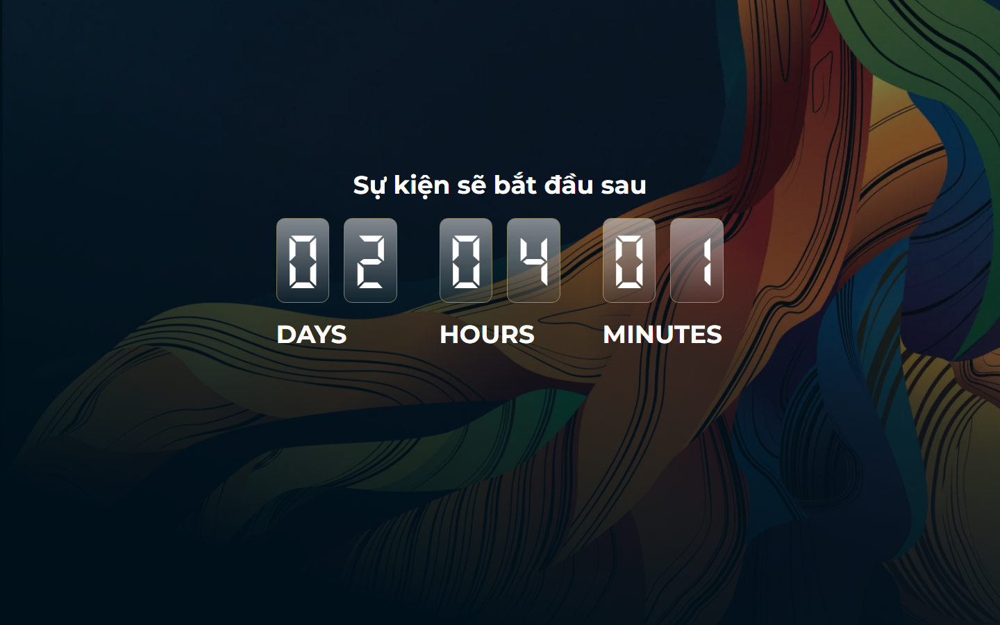

*Trang đếm ngược `/countdown`.*

#### 2. Đăng nhập bằng Google

`/login` · Công khai

- Một nút đăng nhập Google; chỉ tài khoản `@sun-asterisk.com` vào được, tài khoản khác chỉ thấy một thông báo lỗi chung.
- Bộ chọn ngôn ngữ ngay trên trang (Việt/Anh).
- Mở một link Kudo khi chưa đăng nhập: đăng nhập xong được đưa lại đúng Kudo đó.
- Đã đăng nhập mà mở `/login` thì được chuyển sang `/`.

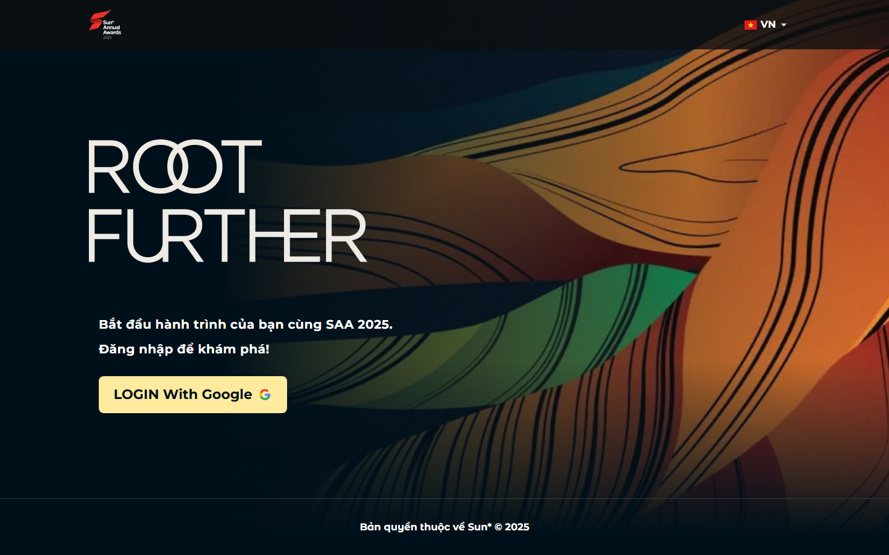

*Trang đăng nhập `/login`.*

#### 3. Trang chủ

`/` · Công khai (khách và Sunner đều xem được)

- Hero có đồng hồ đếm ngược tới lễ trao giải (`AWARDS_CEREMONY_AT`), khối ROOT FURTHER, giới thiệu hệ thống giải và khối Sun\* Kudos, rồi footer.
- Khách: header có nút "Đăng nhập". Sunner: header có chuông thông báo (panel hiện chưa có thông báo) và menu tài khoản (Profile, Sign out; admin có thêm Dashboard).
- Widget nổi ở góc phải mở "Thể lệ" và "Viết KUDOS"; khách đọc được Thể lệ, còn "Viết KUDOS" dẫn sang `/login`.


*Trang chủ `/` với khách: header có nút Đăng nhập.*


*Trang chủ `/` với Sunner đã đăng nhập: chuông và menu tài khoản.*

#### 4. Hệ thống giải thưởng

`/awards-information` · Sunner

- Sáu giải: Top Talent, Top Project, Top Project Leader, Best Manager, Signature 2025 Creator, MVP.
- Menu danh mục dính bên trái làm nổi giải đang xem khi cuộn; bấm menu thì cuộn mượt tới đúng giải.
- Link `#<slug>` mở thẳng tới giải đó (từ trang chủ bấm vào từng giải).


*Trang `/awards-information`.*

#### 5. Sun\* Kudos: bảng Live

`/sun-kudos` · Sunner

- **Highlight Kudos:** băng chuyền 5 Kudo nhiều tim nhất, lọc được theo hashtag và phòng ban; bộ lọc nằm trên URL (`?hashtag=<slug>&department=<code>`).
- **Spotlight Board:** bảng kéo thả và thu phóng, hiện tên người nhận Kudo; có ô tìm theo tên và dòng tin Kudo mới nhất chạy ở góc.
- **All Kudos:** toàn bộ Kudo, mới nhất trước, cuộn xuống là tải thêm; thả tim, Copy Link, bấm vào nội dung để xem chi tiết.
- **Thống kê cá nhân:** số Kudo đã nhận, đã gửi, số tim và số Secret Box; **danh sách người nhận quà** mới nhất (nút "Mở Secret Box" hiện chưa dùng được).
- Mỗi khối tải riêng: một khối lỗi thì chỉ khối đó báo lỗi chung.

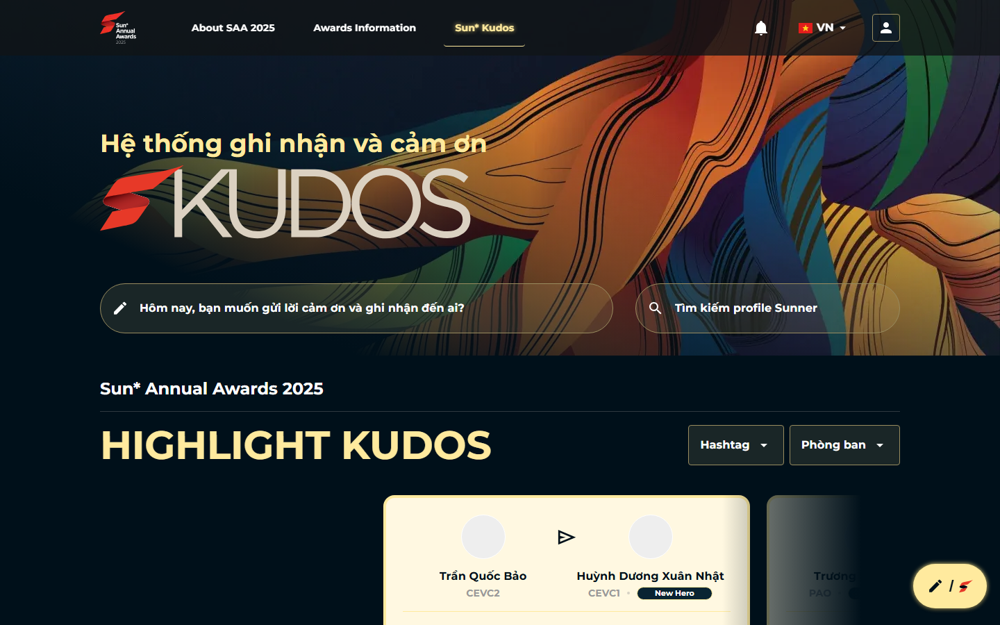

*Bảng Live `/sun-kudos`: banner, Highlight Kudos.*

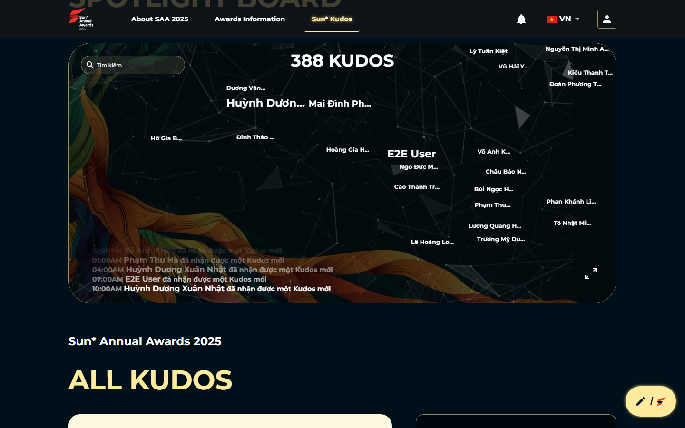

*Spotlight Board trên `/sun-kudos`.*

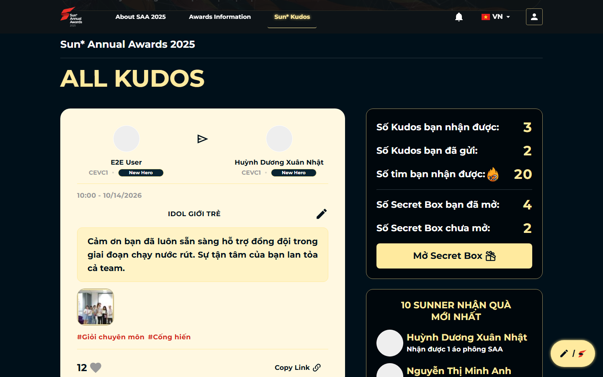

*All Kudos, thống kê và danh sách người nhận quà trên `/sun-kudos`.*

#### 6. Tìm kiếm profile Sunner

`/sun-kudos` · Sunner

- Ô "Tìm kiếm profile Sunner" cạnh nút soạn Kudo gợi ý ngay khi gõ (chờ 150 ms).
- Tìm theo tên hoặc email, không phân biệt dấu; tối đa 10 người, không gồm chính mình và không hiện email.
- Chọn một người thì mở hồ sơ của họ tại `/profile/<id>`; dùng được bằng bàn phím.

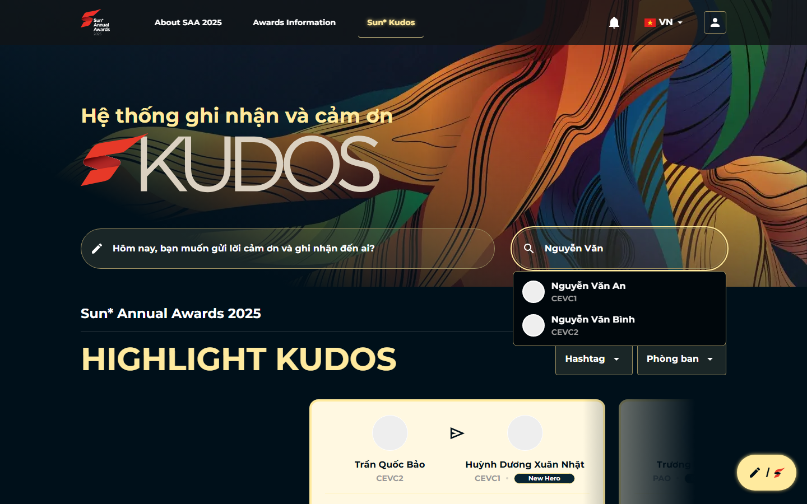

*Ô tìm profile Sunner với danh sách gợi ý.*

#### 7. Viết Kudo

Widget nổi hoặc nút soạn trên `/sun-kudos`; cũng mở từ hồ sơ người khác · Sunner

- Chọn người nhận (gõ tên hoặc email, hoặc `@tên`), nhập tiêu đề (1-100 ký tự) và nội dung (1-5000 ký tự, có đậm, nghiêng, gạch, danh sách, trích dẫn, link, `@mention`).
- Chọn 1-5 hashtag, đính kèm tối đa 5 ảnh JPEG, PNG hoặc WebP (mỗi ảnh tối đa 5 MB; thông tin cá nhân trong ảnh được gỡ khi tải lên).
- Có thể gửi ẩn danh kèm bí danh (tối đa 50 ký tự): người xem không biết ai gửi, kể cả người nhận.
- Nội dung quá dài hay thiếu trường thì form báo ngay; gửi xong thẻ mới hiện trên bảng.

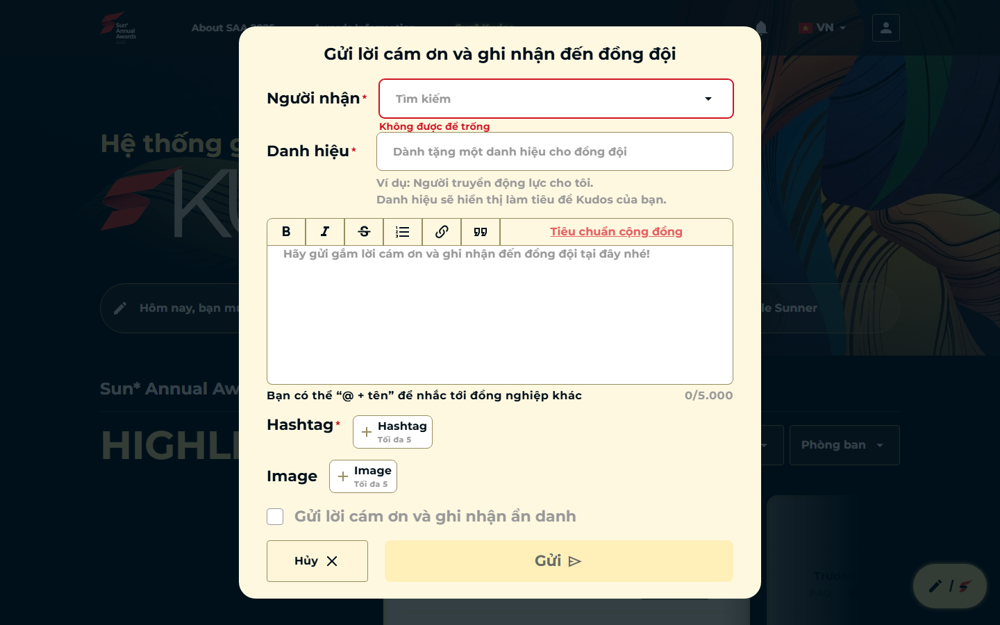

*Modal Viết Kudo.*

#### 8. Sửa Kudo

Nút bút chì trên thẻ Kudo của chính mình (bảng Live và hồ sơ) · Sunner

- Chỉ hiện trên Kudo mình đã gửi; mở cùng modal ở chế độ sửa, điền sẵn nội dung cũ.
- Sửa được tiêu đề, nội dung, hashtag, ảnh (tối đa 5) và bí danh; không đổi được người nhận và chế độ ẩn danh.
- Lưu xong thẻ đổi tại chỗ, tim, thời gian và vị trí giữ nguyên. Hủy thì bỏ bản sửa.

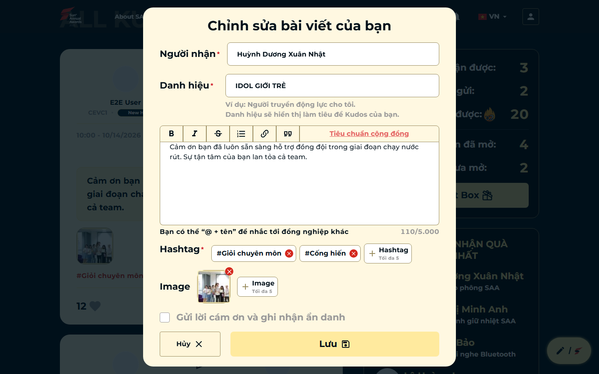

*Modal sửa một Kudo đã gửi.*

#### 9. Thả tim

Trái tim trên mọi thẻ Kudo · Sunner

- Bấm để thả tim, bấm lại để bỏ; số tim đổi ngay, lỗi thì trả về số cũ kèm thông báo.
- Một Kudo hiện ở hai nơi (Highlight và All Kudos) thì cả hai cùng đổi.
- Không thả được tim cho Kudo của chính mình.
- Tim cộng cho người **gửi** Kudo; ngày đặc biệt được nhân đôi số tim (cấu hình bằng SQL).

Nút tim xuất hiện ở các thẻ trong ảnh 08 và 12.

#### 10. Xem chi tiết Kudo và chia sẻ link

`/sun-kudos/<id>` · Sunner

- Mở từ "Xem chi tiết" trên thẻ Highlight, từ nội dung thẻ All Kudos hoặc từ Spotlight Board.
- Hiện đủ nội dung có định dạng, ảnh, hashtag, tim; Kudo ẩn danh vẫn giấu người gửi.
- "Copy Link" chép địa chỉ `/sun-kudos/<id>` kèm thông báo; người nhận link đăng nhập xong sẽ vào đúng Kudo.
- Nút Đóng quay lại trang trước (hoặc `/sun-kudos`). `id` sai dạng hoặc không có thì ra trang 404.

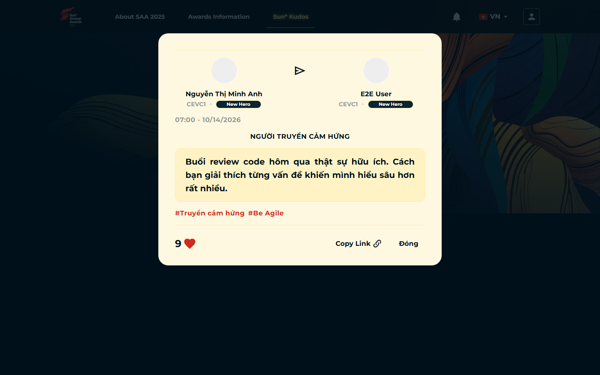

*Trang xem chi tiết một Kudo.*

#### 11. Hồ sơ của mình và của Sunner khác

`/profile` và `/profile/<id>` · Sunner

- Hero: ảnh đại diện, tên, phòng ban, huy hiệu Hero (theo số người gửi Kudo: New 1-4, Rising 5-9, Super 10-20, Legend 21 trở lên) và sao theo số Kudo đã nhận. Sáu ô icon xám bên dưới chưa có nội dung.
- Hồ sơ của mình: thẻ thống kê và danh sách Kudo với lựa chọn "Đã nhận" hoặc "Đã gửi".
- Hồ sơ người khác: thanh "Gửi lời cám ơn và ghi nhận tới ..." mở sẵn Viết Kudo với người đó, và số Kudo đã nhận. Danh sách "Đã gửi" của người khác không bao giờ hiện, vì sẽ lộ ai gửi Kudo ẩn danh.
- Cả hai danh sách cuộn xuống là tải thêm (10 thẻ mỗi lần).

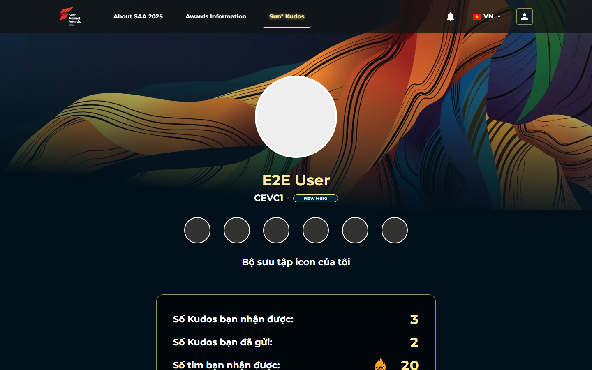

*Hồ sơ của mình `/profile`.*

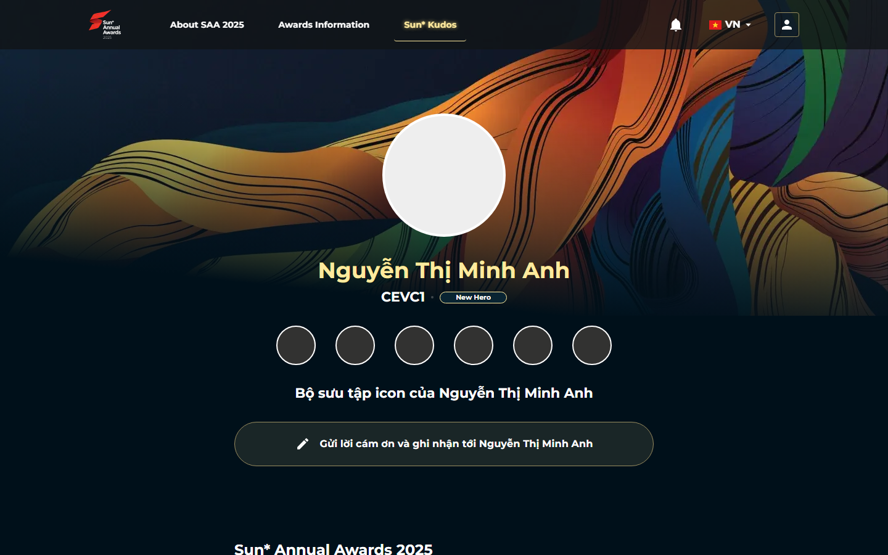

*Hồ sơ của một Sunner khác `/profile/<id>`.*

#### 12. Tiêu chuẩn cộng đồng

`/tieu-chuan-chung` · Công khai

- Mười tiêu chuẩn cộng đồng và hai tiêu chuẩn bảo mật, kèm dòng liên hệ.
- Mở từ link "Tiêu chuẩn chung" ở footer, hoặc "Tiêu chuẩn cộng đồng" trên thanh công cụ Viết Kudo (mở tab mới).
- Khách cũng xem được; trang có header và footer chung, không có widget Viết KUDOS.

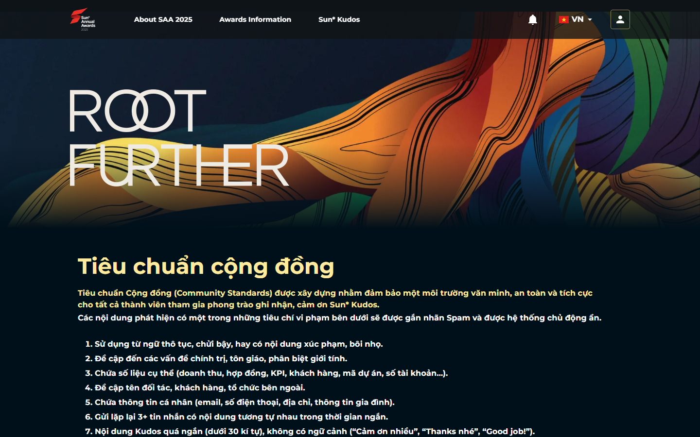

*Trang `/tieu-chuan-chung`.*

#### 13. Widget nổi và Thể lệ

Góc phải trang chủ, `/awards-information`, `/sun-kudos` · Công khai (một phần) / Sunner

- Bấm widget mở menu: "Thể lệ", "Viết KUDOS" và nút đóng; Esc hoặc bấm ra ngoài thì đóng.
- "Thể lệ" giải thích huy hiệu Hero cho người nhận, sưu tập sáu icon cho người gửi và "Kudos Quốc Dân".
- Khách đọc được Thể lệ; "Viết KUDOS" của khách dẫn sang `/login`.

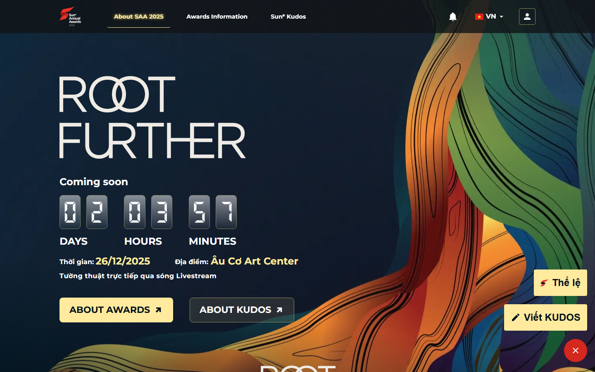

*Menu của widget nổi.*

#### 14. Đổi ngôn ngữ Việt/Anh

Bộ chọn ngôn ngữ ở header và trang đăng nhập · Công khai

- Chọn xong trang tải lại bằng ngôn ngữ mới; lựa chọn được nhớ một năm trong cookie.
- Địa chỉ trang không đổi theo ngôn ngữ (`/login` vẫn là `/login`).
- Các tab khác của trình duyệt tự cập nhật theo.

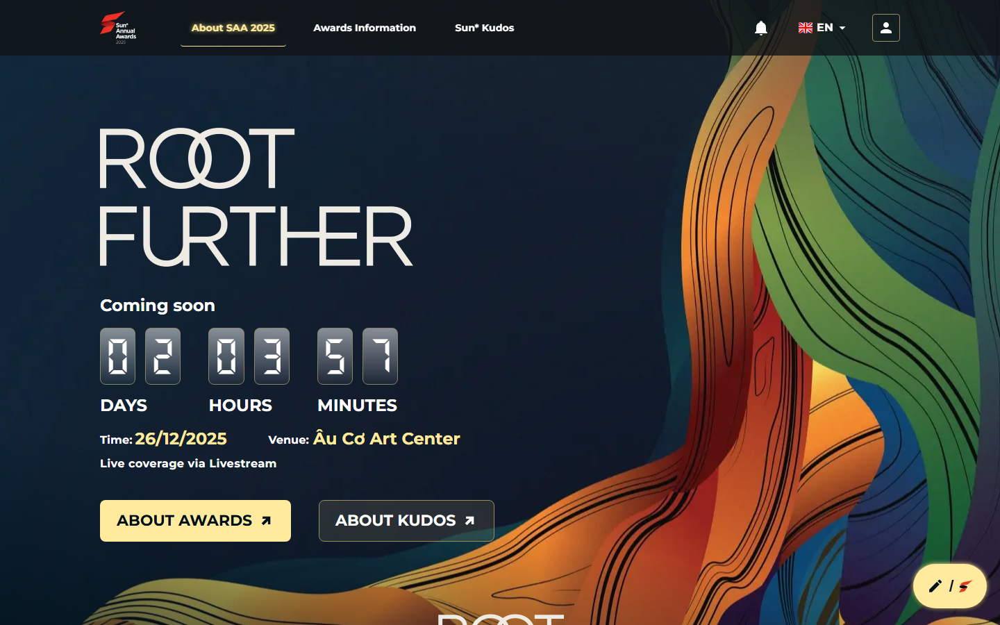

*Trang chủ khi chọn tiếng Anh.*

#### 15. Trang lỗi 404 và 403

Mọi đường dẫn không tồn tại (404) · Sunner; `/403` · Công khai

- 404: Sunner đã đăng nhập ở một đường dẫn không có thì thấy trang này, kèm nút "Về trang chủ". Khách ở đường dẫn như vậy được chuyển về `/login`.
- 403: hiện khi Sunner không đủ quyền (ví dụ mở `/admin` khi không phải admin); trả HTTP 403 thật và không chứa dữ liệu nào.

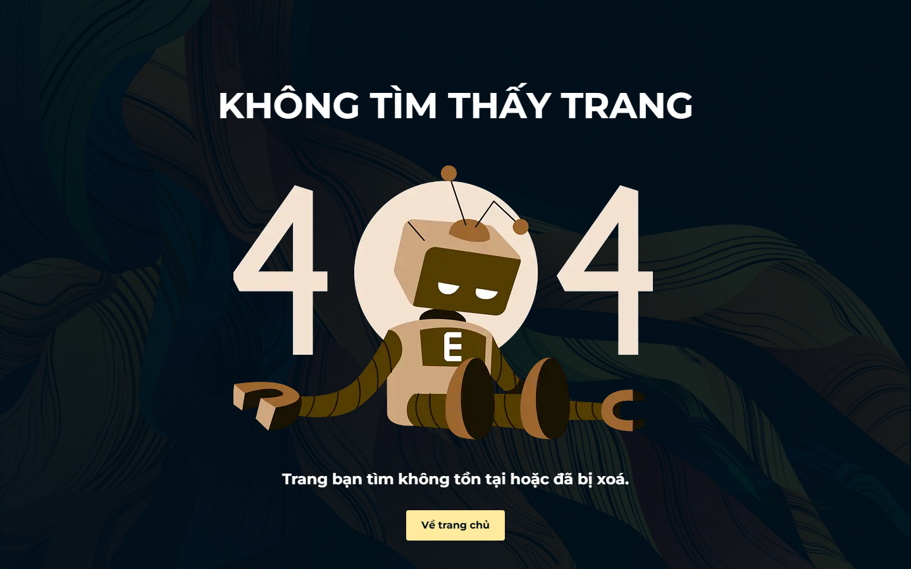

*Trang 404.*

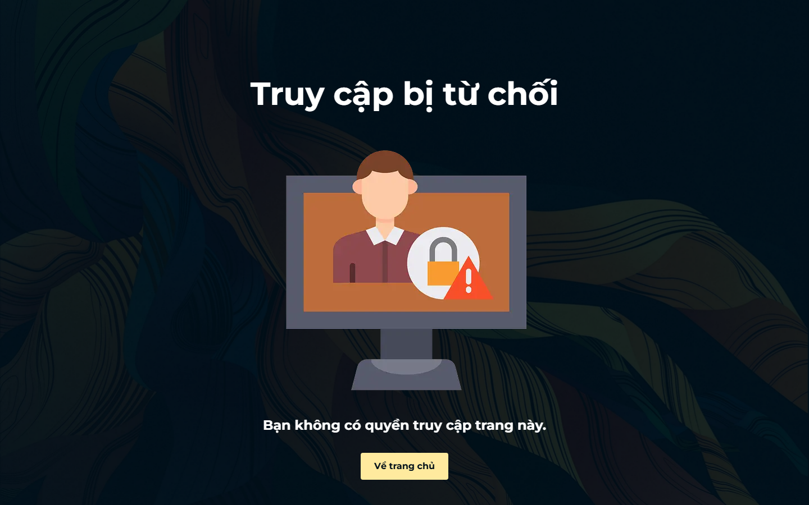

*Trang 403 `/403`.*

#### 16. Giao diện di động

Mọi trang · theo quyền của từng trang

- Bố cục ưu tiên màn hình nhỏ, E2E kiểm ở bề rộng 375 px; vùng chạm theo quy ước dự án là 44 px.
- Menu, bộ lọc, modal Viết Kudo và danh sách đều dùng được trên màn hình nhỏ.

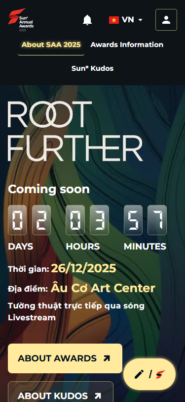

*Trang chủ ở bề rộng 375 px.*


*Bảng `/sun-kudos` ở bề rộng 375 px.*

### Tính năng sẽ làm sau

Chỉ gồm các mục đã được ghi là chưa làm, giới hạn đã biết hoặc hoãn trong tài liệu và kế hoạch của dự án.

| Mục chưa làm | Ghi ở |
|---|---|
| Thông báo: chuông trên header chỉ mở panel rỗng "Chưa có thông báo", chưa có nguồn dữ liệu | `docs/codebase-summary.md` (`notification-button`); `plans/261012-1549-homepage-saa/clarifications.md` |
| Secret Box: nút "Mở Secret Box" chưa dùng được, sáu ô icon trên hồ sơ luôn xám | `docs/codebase-summary.md` (mục "Chưa có"); `plans/261021-profile/clarifications.md` |
| Hover vào tên để xem hồ sơ nhanh, bấm tiêu đề thẻ để lọc, mục "10 Sunner thăng hạng", cập nhật realtime trên bảng Live | `plans/261015-1010-sun-kudos-live-board/plan.md` (mục Deferred) |
| Lối sửa Kudo trên thẻ Highlight và trang xem chi tiết; chưa có dấu "đã sửa" trên thẻ | `docs/technical-overview.md` (Sửa Kudo); `plans/261022-edit-kudo/plan.md` |
| Link `@mention` trong trang xem chi tiết hiện là chữ thường, chưa bấm được | `plans/261022-edit-kudo/plan.md` (mục Deferred) |
| Sửa thông tin cá nhân (tên, ảnh, phòng ban) trên hồ sơ | `docs/project-changelog.md` (mục Hồ sơ) |
| Chống gửi trùng Kudo (khoá idempotency), giới hạn tần suất gửi, quota ảnh, dọn ảnh mồ côi | `plans/261019-1022-write-kudos/plan.md` (mục Deferred) |
| Đổi ngôn ngữ phải tải lại cả trang, chưa làm mới mềm | `docs/project-changelog.md`; `docs/technical-overview.md` (mục Ngôn ngữ) |
| Kiểm tra trên Worker thật: giới hạn bộ nhớ khi gửi 5 ảnh, header cache của trang đổi ngôn ngữ, luồng OAuth thật | `docs/technical-overview.md` (mục Viết Kudo và Triển khai); `plans/261014-1115-multi-language-vi-en/plan.md` |

---

## Phần 2: Quản trị (Admin)

> Khu Admin chỉ dành cho vai trò `admin`. Ảnh chụp trên dữ liệu giả của bộ test.

### Tính năng đã làm

#### 1. Vào khu Admin và menu Dashboard

`/admin` · Admin

- Admin thấy mục **Dashboard** trong menu tài khoản (giữa Profile và Sign out); bấm vào mở `/admin`.
- `/admin` chuyển thẳng sang `/admin/users` (các tab khác chưa có trang).
- Vai trò luôn được hỏi lại CSDL ở mỗi request nên hạ quyền có hiệu lực ngay.

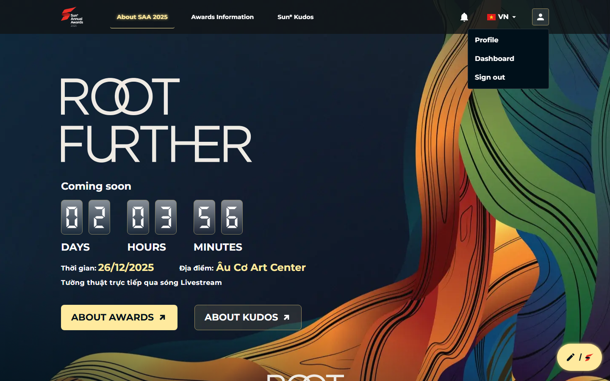

*Menu tài khoản của admin với mục Dashboard.*

#### 2. Bảng người dùng: lọc, tìm, sắp xếp, phân trang

`/admin/users` · Admin

- Bảng 20 người mỗi trang, cột: Sent, Received, Total Heart, Level, Badges, Time to get 6 Badges, Last Logged in, Role.
- Lọc theo Unit, Level, Role; tìm theo tên hoặc email (gõ rồi chờ 300 ms); sắp xếp theo bảy cột.
- Toàn bộ trạng thái nằm trên URL (`unit`, `level`, `role`, `q`, `sort`, `dir`, `page`) nên chia sẻ và mở lại được; giá trị sai tự về mặc định.
- Total Heart chỉ tính Kudo gửi không ẩn danh, và Kudo ẩn danh chỉ góp vào con số Sent: admin không suy ra được ai gửi Kudo ẩn danh.

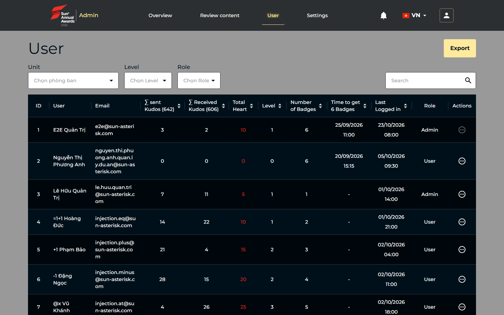

*Bảng người dùng `/admin/users`.*

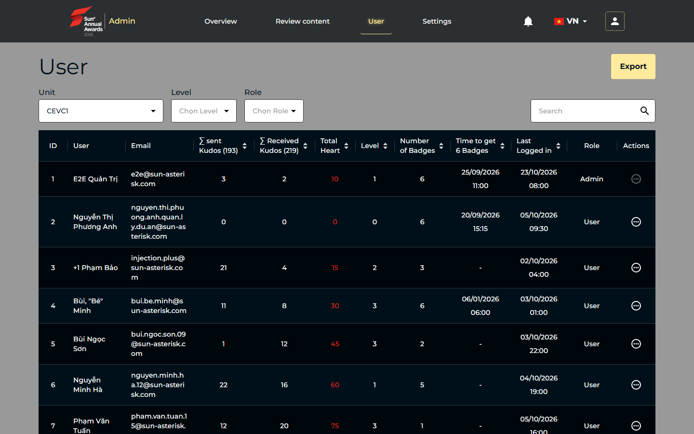

*Bảng người dùng khi lọc và tìm.*

#### 3. Đổi vai trò người dùng

Nút "..." trên mỗi dòng · Admin

- Chọn "Change to Admin" hoặc "Change to User", rồi xác nhận trong hộp thoại.
- Admin không đổi được vai trò của chính mình (nút bị vô hiệu), nên admin cuối cùng không tự gỡ quyền được.
- Lỗi nào cũng chỉ hiện một dòng chung và hộp thoại giữ nguyên để thử lại.

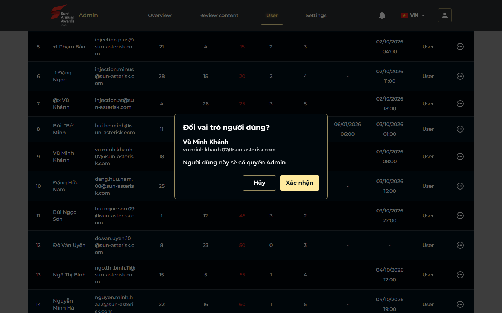

*Hộp thoại xác nhận đổi vai trò.*

#### 4. Xuất CSV

`/admin/users/export` · Admin

- Liên kết xuất lấy đúng bộ lọc và thứ tự đang xem; tải toàn bộ kết quả, không chỉ trang hiện tại.
- Tên file `users-YYYYMMDD.csv`, mã hoá UTF-8 có BOM, tiêu đề cột tiếng Anh cố định.
- Ô bắt đầu bằng `=`, `+`, `-`, `@` được thêm dấu `'` để Excel không chạy thành công thức.
- Tất cả hoặc không: lỗi giữa chừng thì báo lỗi, quá 5000 dòng thì từ chối; file không bao giờ bị cắt lặng lẽ.

Liên kết xuất nằm trên trang bảng người dùng (ảnh 31).

#### 5. Chặn người không phải admin

`/admin/*` · Sunner (không phải admin) và khách

- Sunner không phải admin nhận trang 403, HTTP 403 thật và không có dữ liệu người dùng nào trong HTML.
- Khách bị đưa về `/login` (đăng nhập xong về `/`, không quay lại `/admin`).
- Đường dẫn xuất CSV cũng trả 403 cho người không phải admin.


*Sunner không phải admin mở `/admin/users`.*

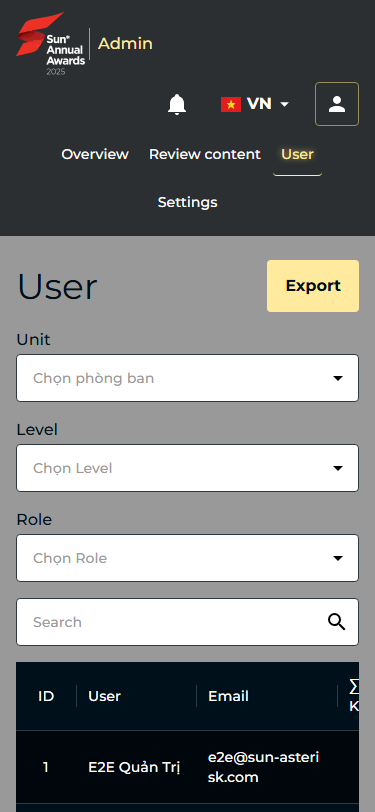

*Bảng người dùng ở bề rộng 375 px.*

### Tính năng sẽ làm sau

| Mục chưa làm | Ghi ở |
|---|---|
| Các trang Overview, Review content, Settings (ba tab trên header Admin hiện chưa bấm được) | `docs/technical-overview.md` (mục Admin); `docs/codebase-summary.md` (mục "Chưa có"); `plans/261023-1207-admin-user-management/clarifications.md` |
| Nhật ký đổi vai trò | `docs/project-changelog.md`; `docs/system/permissions.md` |
| Sửa phòng ban của người dùng (hiện chỉ seed demo điền được; bộ lọc Unit trống trên production tới khi có dữ liệu) | `docs/project-changelog.md`; `plans/261023-1207-admin-user-management/clarifications.md` |
| Sau khi đăng nhập, khách mở `/admin` được quay lại `/admin` (hiện về `/`) | `docs/system/permissions.md`; `plans/261023-1207-admin-user-management/plan.md` |
| Giao diện cấu hình ngày nhân đôi tim (hiện chỉ cấu hình bằng SQL ở bảng `special_heart_days`) | `plans/261020-1429-like-kudos/clarifications.md` |
| Kiểm tra CSV mở trong Excel (dấu phẩy) | `plans/261023-1207-admin-user-management/plan.md` (mục Deferred) |

---

## Server Actions và Route Handlers

Dự án không có REST API riêng: thao tác của người dùng đi qua **Server Action** (kiểm Origin tự động của Next.js) và hai **Route Handler**. Quyền thật nằm ở cơ sở dữ liệu: các hàm RPC từ chối người không đủ điều kiện.

| Tên | File | Ai gọi được | Làm gì |
|---|---|---|---|
| `signInWithGoogle` | `lib/auth/sign-in-with-google.ts` | Khách (form ở `/login`) | Kiểm Origin, bắt đầu OAuth Google (PKCE), ghi cookie quay lại Kudo nếu `next` hợp lệ |
| `signOut` | `lib/auth/sign-out.ts` | Sunner (menu tài khoản) | Đăng xuất phiên của trình duyệt này, luôn về `/login` |
| `setLocale` | `lib/i18n/set-locale-action.ts` | Mọi người | Lưu ngôn ngữ vào cookie `NEXT_LOCALE` (1 năm) |
| `loadMoreKudos` | `lib/kudos/load-more-kudos-action.ts` | Sunner | Trang kế của All Kudos (cuộn vô hạn, giữ bộ lọc) |
| `searchProfiles` | `lib/kudos/search-profiles-action.ts` | Sunner | Gợi ý ô "Tìm kiếm profile Sunner" (tên hoặc email, tối đa 10) |
| `searchSunners` | `lib/kudos/search-sunners-action.ts` | Sunner | Gợi ý người nhận và `@mention` khi viết Kudo |
| `getHashtagOptions` | `lib/kudos/get-hashtag-options-action.ts` | Sunner | Danh mục hashtag cho ô "+ Hashtag" |
| `createKudo` | `lib/kudos/create-kudo-action.ts` | Sunner | Kiểm dữ liệu và ảnh, tải ảnh lên Storage, gọi `create_kudo` |
| `updateKudo` | `lib/kudos/update-kudo-action.ts` | Sunner, chỉ người đã gửi Kudo đó | Sửa Kudo qua `update_kudo`, xoá ảnh đã bỏ khỏi Storage |
| `setKudoHeart` | `lib/kudos/set-kudo-heart-action.ts` | Sunner (không tim Kudo của mình) | Đặt trạng thái tim qua `set_kudo_heart`, trả số tim mới |
| `loadMoreProfileKudos` | `lib/profiles/load-more-profile-kudos-action.ts` | Sunner (danh sách "Đã gửi" chỉ của chính mình) | Trang kế danh sách Kudo trên hồ sơ |
| `setUserRole` | `lib/admin/set-user-role-action.ts` | Admin (không đổi vai trò của chính mình) | Đổi vai trò người dùng qua `admin_set_user_role` |

| Route Handler | File | Ai gọi được | Làm gì |
|---|---|---|---|
| `GET /auth/callback` | `app/auth/callback/route.ts` | Công khai (Supabase chuyển về) | Đổi `code` lấy phiên, loại email ngoài `@sun-asterisk.com`, chuyển về `/` hoặc đúng Kudo, xoá cookie `saa_post_login_next` |
| `GET /admin/users/export` | `app/[locale]/admin/users/export/route.ts` | Admin (người khác nhận 403) | Trả CSV người dùng theo bộ lọc; 413 nếu quá 5000 dòng, 500 nếu một khúc dữ liệu lỗi |

Cả hai Route Handler hiện chỉ là `GET`. Route Handler làm thay đổi dữ liệu (nếu thêm sau này, dưới `app/api/*`) không có kiểm Origin tự động như Server Action: phải tự kiểm Origin/Referer trước khi xử lý (quy ước trong `CLAUDE.md`).

---

## Vai trò và phân quyền

Có đúng hai vai trò lưu ở `profiles.role` (`user` mặc định, `admin`), cộng với khách chưa đăng nhập. Vai trò luôn đọc từ cơ sở dữ liệu qua `is_admin()`, không nằm trong JWT.

| Hành động | Khách | Sunner | Admin |
|---|---|---|---|
| Xem trang đếm ngược (trước giờ mở) | Có | Có | Có |
| Xem `/`, `/login`, `/tieu-chuan-chung`, `/403` (sau giờ mở) | Có | Có | Có |
| Đọc panel Thể lệ | Có | Có | Có |
| Xem `/awards-information`, bảng Live, xem Kudo, hồ sơ | Không (về `/login`) | Có | Có |
| Viết Kudo, tìm Sunner | Không | Có | Có |
| Sửa Kudo | Không | Chỉ Kudo mình gửi | Chỉ Kudo mình gửi |
| Thả tim | Không | Có (không tim Kudo của mình) | Có (không tim Kudo của mình) |
| Xem danh sách Kudo "Đã gửi" | Không | Chỉ của mình | Chỉ của mình |
| Vào `/admin/*`, xuất CSV | Không (về `/login`) | Không (403) | Có |
| Đổi vai trò người khác | Không | Không | Có (không đổi chính mình) |

Điều kiện chung: tài khoản phải là Google với email `@sun-asterisk.com`; tài khoản ngoài tên miền không đăng nhập được. Kudo ẩn danh luôn giấu người gửi (kể cả với người nhận và admin). Nhiều lớp bảo vệ: cổng thời gian (chạy trước, không có ngoại lệ), chặn mặc định ở `proxy.ts`, kiểm lại phiên ở từng trang và Server Action, và RLS cùng kiểm tra trong hàm SQL. Bảng đầy đủ bằng tiếng Việt: [`docs/system/permissions.md`](docs/system/permissions.md).

---

## Kiểm thử

| Lệnh | Tác dụng |
|---|---|
| `npm test` | Unit test bằng Vitest (`tests/unit/`): hàm thuần và Server Action trong `lib/` |
| `npm run test:e2e` | `next build` rồi Playwright (`tests/e2e/`, trình duyệt chromium) |
| `npm run lint` | ESLint, chạy trước khi commit |

- Lần đầu chạy E2E: `npx playwright install chromium`.
- E2E khởi động bốn server ứng dụng: cổng **3100** (mốc mở ở tương lai), **3101** (mốc đã qua), **3102** (mốc không hợp lệ), **3103** (đã mở, nối với Supabase giả), cùng Supabase giả ở `127.0.0.1:54398`. Không cần project Supabase thật.
- Ngoài CI, Playwright dùng lại server đang chạy ở các cổng này: tắt `next start` cũ trước khi chạy, nếu không bản build cũ có thể làm sai kết quả.
- Supabase giả ký JWT và phát JWKS để `getClaims()` thật của proxy tự kiểm chữ ký; code production không có đường tắt cho test. Các hàm RPC giả phản chiếu SQL thật nên E2E **không bắt được lỗi SQL**: mỗi migration mới phải chạy file verify trên project thật.
- Một thay đổi chỉ chạm tài liệu hay chữ giao diện thì chỉ cần kiểm phần đã sửa; thay đổi chạm xác thực, phân quyền, migration, cấu hình hay deploy thì chạy đủ bộ.

Hạ tầng và danh sách bộ test: [`docs/technical-overview.md`](docs/technical-overview.md#17-kiểm-thử).

---

## Triển khai

Triển khai lên **Cloudflare Workers** qua `@opennextjs/cloudflare`: `wrangler.jsonc` (cờ `nodejs_compat`, binding `ASSETS`, `IMAGES`, `WORKER_SELF_REFERENCE`) và `open-next.config.ts`.

1. **Chạy migration trên Supabase trước** (xem [Cơ sở dữ liệu và migration](#cơ-sở-dữ-liệu-và-migration)), rồi chạy file verify. Riêng Admin: thiếu `is_admin()` thì app khoá khi lỗi và log lỗi ở mọi trang của người đã đăng nhập.
2. **Đặt cấu hình:** `EVENT_START_AT` và `AWARDS_CEREMONY_AT` trong `vars` của `wrangler.jsonc`; hai khoá Supabase trên dashboard Cloudflare hoặc `wrangler secret put` (không để secret trong `vars`).
3. **Dashboard Supabase:** bật Google, thêm `<origin>/auth/callback` vào redirect URL.
4. **Xem thử cục bộ:** `npm run preview` (build OpenNext, chạy trên workerd).
5. **Triển khai:** `npm run deploy`.
6. **Gán admin đầu tiên** bằng SQL (xem [Dữ liệu mẫu](#dữ-liệu-mẫu)).

Lưu ý:

- **Giới hạn kích thước Worker:** 3 MiB (gói free) hoặc 10 MiB (gói trả phí), tính sau gzip. Đo ngày 2026-10-26: 2350.57 KiB; cân nhắc kỹ khi thêm thư viện nặng.
- `cacheComponents` và `partialPrefetching` đang tắt trong `next.config.ts` (bật thì route có `<Suspense>` động bị treo trên Workers, lỗi 1101). Chỉ bật lại khi OpenNext có bản sửa và đã thử bằng `npm run preview`.
- `patches/@opennextjs+cloudflare+*.patch` vá lỗi `preview-props.json` của Next 16.4; xoá patch khi upstream có bản sửa.
- Header bảo mật: route động đặt qua `next.config.ts`, asset tĩnh qua `public/_headers`; hai cơ chế không thay thế nhau. Rate limiting dùng Cloudflare Rate Limiting Rules, cấu hình trên Cloudflare.
- Chưa kiểm trên Worker đã triển khai: giới hạn bộ nhớ khi gửi 5 ảnh, `Cache-Control` của trang đổi ngôn ngữ, luồng OAuth thật.

---

## Tài liệu khác

| File | Nội dung |
|---|---|
| [`docs/technical-overview.md`](docs/technical-overview.md) | Tài liệu kỹ thuật đầy đủ: kiến trúc, đăng nhập, từng tính năng, migration, kiểm thử, triển khai |
| [`docs/codebase-summary.md`](docs/codebase-summary.md) | Vai trò từng thư mục và file |
| [`docs/system/permissions.md`](docs/system/permissions.md) | Ai được mở và làm gì (tiếng Việt) |
| [`docs/project-changelog.md`](docs/project-changelog.md) | Thay đổi hành vi đáng chú ý, mới nhất trước (tiếng Việt) |
| [`CLAUDE.md`](CLAUDE.md) | Stack, quy ước viết code, bảo mật |
