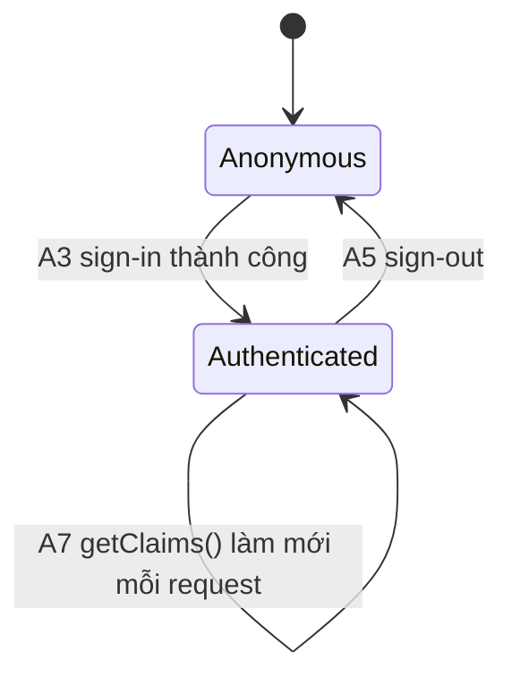

# F000_ProjectFoundation

**Priority**: P0
**Type**: background
**Generated**: 2026-10-08

**See also:** [`functional-spec.md`](./functional-spec.md) — tổng quan plain-language, open
decisions, requirements/business rules dạng one-liner, screens, user stories, scenarios, edge
cases và configuration dành cho BA/QA.

**How to read this file:** § 2 là bảng chỉ mục — chọn action cần xem rồi đọc trọn block của nó ở
§ 3. § 4 là phần phụ lục dùng chung — chỉ cần mở khi một block ở § 3 trỏ tới đó.

## 1. Technical Overview

Tính năng này dựng nền tảng hạ tầng cho toàn bộ ứng dụng Next.js 16: pipeline build/deploy lên
Cloudflare Workers qua OpenNext (`@opennextjs/cloudflare`), bộ Supabase client ba lớp
(browser/server/admin) cùng luồng xác thực cookie-based qua `@supabase/ssr`, baseline bảo mật
(header, CSRF, cô lập secret, validate input, chống lộ lỗi nội bộ), quy ước tổ chức code/responsive,
và một health-check endpoint xác minh Worker gọi được tới Supabase. Developer là người thiết lập và
bảo trì; End User chỉ chạm vào phần đăng nhập/đăng ký/đăng xuất; Release Engineer dùng health-check
sau mỗi lần deploy. Chưa có dòng code nào được viết — mọi mục dưới đây là ý định thiết kế
(`status: draft`), chưa có `**Source:**` trích dẫn thật.

## 2. Action Index

| # | Action (handler) | Method · Path | Codes | Writes | Detail |
|---|---|---|---|---|---|
| **A0** | *cross-cutting — belongs to no single action* | — | FR-003, FR-004, FR-005, FR-601, FR-602, FR-603, FR-604, BR-001, BR-002, BR-003, BR-004, BR-006, BR-007, US002, US003, US006 | — | § 4.4 |
| **A1** | `cf:deploy` (npm script, planned) | — | FR-001, US001 | — *(no DB write)* | § 3.1 |
| **A2** | `lib/supabase/{client,server,admin}.ts` (planned) | — | FR-002 | — *(no DB write — connection setup only)* | § 3.2 |
| **A3** | `AuthActions#signIn` (planned) | Server Action | FR-401, BR-005, SM-001, US004 | `auth.sessions` *(external, Supabase-managed)* | § 3.2 |
| **A4** | `AuthActions#signUp` (planned) | Server Action | FR-402, US004 | `auth.users` *(external, Supabase-managed)* | § 3.2 |
| **A5** | `AuthActions#signOut` (planned) | Server Action | FR-403, BR-005, SM-001, US004 | `auth.sessions` *(external, Supabase-managed)* | § 3.2 |
| **A6** | `AuthCallbackRoute#GET` (planned) | `GET` `/auth/callback` | FR-404, US004 | `auth.sessions` *(external, Supabase-managed)* | § 3.2 |
| **A7** | `proxy#middleware` (planned) *(background, no FE)* | — | FR-405, BR-005, SM-001, US004 | — *(read-only — chỉ ghi lại cookie, không ghi bảng)* | § 3.2 |
| **A8** | `HealthCheckRoute#GET` (planned) | `GET` `/api/health` | FR-006, US005 | — *(read-only)* | § 3.5 |

## 3. Actions

### 3.1 CAP-01 — Cloudflare Workers Deployment

#### A1 · Build và deploy lên Cloudflare Workers
`cf:deploy` (npm script) → `` `opennextjs-cloudflare build && wrangler deploy` ``
`FR-001` · `US001`

**Who** · Developer, chạy thủ công hoặc từ CI *(gate A0 — § 4.4)*
**BE** · `` `opennextjs-cloudflare build` `` đóng gói `next build` output thành Worker runnable trên
`nodejs_compat`, sau đó `` `wrangler deploy` `` đẩy `.open-next/worker.js` + `.open-next/assets` lên
Cloudflare. `wrangler.jsonc` (planned, root) khai báo `compatibility_flags: ["nodejs_compat"]` và
`compatibility_date >= 2024-09-23`.
**Rule** · Pipeline phải thất bại rõ ràng (exit code khác 0), trước khi cắt traffic, khi bundle
sau build vượt giới hạn kích thước Worker (3 MiB free / 10 MiB paid, gzip) — ràng buộc riêng của
action này, không phải một Business Rule dùng chung nên không cần mã BR-###.
**Result** · Không ghi DB. Side effect quan sát được: Worker mới được publish, request tiếp theo
tới domain Workers được route sang bản build mới.
**Source:** `TBD (draft)` — chưa có `wrangler.jsonc`/`open-next.config.ts`/script thật để trích dẫn.

<!-- Không vẽ sequence diagram: pipeline 2 bước tuyến tính (build → deploy), không rẽ nhánh, không
     ghi ≥2 bảng — dưới ngưỡng yêu cầu diagram. -->

---

### 3.2 CAP-02 — Supabase Client & Auth Scaffolding

#### A2 · Khởi tạo Supabase client factories
`lib/supabase/{client,server,admin}.ts` (planned)
`FR-002`

**Who** · Developer (hạ tầng dùng chung cho mọi action khác trong CAP-02) *(gate A0)*
**BE** · Ba factory riêng biệt: `client.ts` dùng `createBrowserClient()` cho Client Component;
`server.ts` dùng `createServerClient()` với adapter `cookies().getAll()/setAll()` cho Server
Component/Action/Route Handler; `admin.ts` dùng `createClient()` với secret key, chỉ được import từ
file server-only (BR-002).
**Rule** · Mọi bảng Supabase mà các action dùng client này chạm tới phải bật RLS trước —
**BR-001** *(§ 4.4)*: publishable key là public by design, không có RLS thì key đó đọc/ghi được
mọi dòng.
**Result** · Không ghi DB — chỉ thiết lập kết nối, được A3–A8 tái sử dụng.
**Source:** `TBD (draft)` — chưa có file `lib/supabase/*.ts`.

---

#### A3 · Đăng nhập (Sign In)
Server Action → `` `AuthActions#signIn` ``
`FR-401` `BR-005` `SM-001` `US004`

**Who** · End User, submit form đăng nhập (màn hình UI thuộc feature khác, ngoài phạm vi tính năng
này) *(gate A0)*
**Request** · `email` *(string)*, `password` *(string)*
**BE** · `` `supabase.auth.signInWithPassword({ email, password })` `` qua `lib/supabase/server.ts`.
**Rule** · **BR-005 — Middleware phải gọi `getClaims()` thay vì `getSession()` để làm mới phiên
trên mọi request** — áp dụng từ lần đăng nhập này trở đi, `getSession()` đọc cookie chưa xác thực
chữ ký. *(§ 4.4)*
**Result** · Supabase ghi `auth.sessions` *(external, quản lý bởi Supabase)* — cookie phiên được
Server Action set thông qua response. Sai thông tin đăng nhập trả lỗi chung, không tiết lộ email có
tồn tại hay không (edge case, § 3.6).
**State** · `SM-001`: `Anonymous` → `Authenticated` *(§ 4.3)*
**Source:** `TBD (draft)` — chưa có `app/actions/auth.ts`.

---

#### A4 · Đăng ký (Sign Up)
Server Action → `` `AuthActions#signUp` ``
`FR-402` `US004`

**Who** · End User, submit form đăng ký (ngoài phạm vi UI của tính năng này) *(gate A0)*
**Request** · `email` *(string)*, `password` *(string)*
**BE** · `` `supabase.auth.signUp({ email, password })` `` qua `lib/supabase/server.ts`.
**Rule** · Dùng chung baseline validate đầu vào — **BR-006 — Input Server Action phải validate
bằng schema zod dùng chung trước khi chạy logic nghiệp vụ.** *(§ 4.4)*
**Result** · Supabase ghi `auth.users` *(external, quản lý bởi Supabase)*; tuỳ cấu hình xác minh
email của project mà tài khoản ở trạng thái chờ xác minh hay kích hoạt ngay.
**Source:** `TBD (draft)` — chưa có `app/actions/auth.ts`.

---

#### A5 · Đăng xuất (Sign Out)
Server Action → `` `AuthActions#signOut` ``
`FR-403` `BR-005` `SM-001` `US004`

**Who** · End User đã đăng nhập *(gate A0)*
**Request** · *không có input — phiên đọc từ cookie hiện có*
**BE** · `` `supabase.auth.signOut()` `` qua `lib/supabase/server.ts`.
**Rule** · **BR-005** *(§ 4.4)*: sau khi xoá phiên, lần `getClaims()` kế tiếp phải thấy phiên đã
mất hiệu lực — không được dùng `getSession()` (có thể trả cookie cũ do cache phía client).
**Result** · Supabase xoá `auth.sessions` *(external, quản lý bởi Supabase)*; cookie phiên bị clear
trên response.
**State** · `SM-001`: `Authenticated` → `Anonymous` *(§ 4.3)*
**Source:** `TBD (draft)` — chưa có `app/actions/auth.ts`.

---

#### A6 · Callback xác nhận email (v1: không có OAuth)
`GET` `/auth/callback` → `` `AuthCallbackRoute#GET` ``
`FR-404` `US004`

**Who** · End User, redirect về từ Supabase sau khi bấm link xác nhận email trong hộp thư *(gate A0)*
**Request** · query param `code` *(string)*
**BE** · `` `supabase.auth.exchangeCodeForSession(code)` ``.
**Rule** · GET read-only cho user nhưng *tạo* phiên — không cần CSRF Origin-check (FR-601 chỉ áp
dụng cho Route Handler làm thay đổi dữ liệu nhận request từ trình duyệt với cookie session có sẵn;
request này tới từ redirect của Supabase, chưa có session để giả mạo).
**Result** · Supabase ghi `auth.sessions` *(external, quản lý bởi Supabase)*; redirect người dùng
về trang đích sau khi phiên được tạo. `code` không hợp lệ bị Supabase từ chối, route trả lỗi chung.
**Source:** `TBD (draft)` — chưa có `app/auth/callback/route.ts`.

---

#### A7 · Làm mới phiên trên mọi request *(background, no FE)*
`proxy.ts` (planned) → `` `proxy#middleware` ``
`FR-405` `BR-005` `SM-001` `US004`

**Who** · *không có actor trực tiếp — chạy tự động trên mọi request khớp matcher*
**FE** · *none*
**Request** · *không có body — đọc cookie từ request hiện có*
**BE** · `` `createServerClient()` `` (biến thể middleware) gọi `` `supabase.auth.getClaims()` ``
mỗi request, rồi copy cookie đã rotate sang response.
**Rule** · **BR-005 — phải dùng `getClaims()`, không dùng `getSession()`** *(§ 4.4)* — bỏ bước này
là nguyên nhân phổ biến nhất gây "người dùng tự nhiên bị đăng xuất" theo tài liệu Supabase.
**Result** · Không ghi bảng — chỉ ghi lại cookie phiên đã rotate lên response.
**State** · `SM-001`: `Authenticated` → `Authenticated` *(làm mới, § 4.3)*
**Source:** `TBD (draft)` — chưa có `proxy.ts`.

<!-- Không vẽ sequence diagram: một bước duy nhất (đọc cookie → getClaims → ghi cookie), không ghi
     bảng, không rẽ nhánh — dưới ngưỡng yêu cầu diagram dù chạy trên mọi request. -->

---

### 3.3 CAP-03 — Security Hardening

Toàn bộ yêu cầu của capability này là cross-cutting — không gắn với một action cụ thể nào mà áp
dụng cho mọi route/action trong toàn ứng dụng (header, CSRF, cô lập secret, RLS, chống lộ lỗi nội
bộ). Nội dung đầy đủ (trích dẫn + pseudocode dự kiến) nằm ở `## 4. Shared Foundation § 4.4 Shared
Rules` dưới `#### Bin 3`, được claim bởi dòng **A0** ở § 2. Riêng FR-603 (RLS bắt buộc trên mọi
bảng) được thực thi ở tầng migration Supabase (`supabase/migrations/*.sql`), không phải ở một
action nào trong ứng dụng.

---

### 3.4 CAP-04 — Code Organization & Responsive Conventions

Tương tự CAP-03, capability này là quy ước áp dụng cho toàn bộ codebase (tổ chức file/thành phần
UI, breakpoint, touch target, `focus-visible`, `motion-safe`/`motion-reduce`), không phải hành vi
runtime của một action cụ thể. Quy ước được ghi nhận ở `## 4. Shared Foundation § 4.1 Components`
và `§ 4.6 Configuration`, claim bởi **A0**.

---

### 3.5 CAP-05 — Deployment Smoke Test

#### A8 · Health-check Worker ↔ Supabase
`GET` `/api/health` → `` `HealthCheckRoute#GET` ``
`FR-006` `US005`

**Who** · Release Engineer hoặc hệ thống giám sát tự động (uptime monitor) *(gate A0)*
**Request** · *không có input*
**BE** · `` `supabase.auth.getUser()` `` (hoặc một lệnh Supabase nhẹ tương đương) qua
`lib/supabase/server.ts` — round-trip một lệnh gọi Supabase thật, không chỉ kiểm tra biến môi
trường tồn tại.
**Rule** · **BR-004 — Lỗi phía server log đầy đủ nội bộ nhưng chỉ trả client một thông điệp
chung, không lộ stack trace.** *(§ 4.4)*
**Result** · Read-only, không ghi bảng. Trả `{ status: "ok" }` khi round-trip thành công; trả
`{ status: "degraded" }` kèm HTTP 503 khi không kết nối được, không có chi tiết lỗi nội bộ trong
body.
**Source:** `TBD (draft)` — chưa có `app/api/health/route.ts`.

<!-- Không vẽ sequence diagram: một lệnh gọi duy nhất, không rẽ nhánh, không ghi bảng. -->

### 3.6 Edge cases

| Action | Scenario | Behavior |
|---|---|---|
| A1 | Bundle sau build vượt giới hạn kích thước Worker | `wrangler deploy` thất bại, exit code khác 0, không có gì được publish |
| A3 | Supabase trả lỗi do sai publishable key/env var | Server Action trả lỗi chung "Invalid login credentials", không lộ chi tiết cấu hình (BR-004) |
| A7 | `proxy.ts` matcher không bao phủ một route cần bảo vệ | Phiên không được làm mới trên route đó; request tiếp theo có thể bị coi là chưa đăng nhập |
| A0 | Route Handler làm thay đổi dữ liệu bị gọi từ Origin lạ | Request bị từ chối trước khi chạm logic nghiệp vụ (BR-003, FR-601) |
| A8 | Supabase không thể truy cập từ Worker (mạng/env var sai) | Health-check trả HTTP 503, body chỉ chứa `{ status: "degraded" }`, không lộ chi tiết nội bộ (BR-004) |

## 4. Shared Foundation

### 4.1 Components

| Component | Responsibility | Used in | File |
|---|---|---|---|
| `OpenNextCloudflareAdapter` | Đóng gói `next build` output thành Worker chạy trên `nodejs_compat` | A1 | `open-next.config.ts` (planned) |
| `SupabaseClientFactory` (browser/server/admin) | Tạo Supabase client đúng ngữ cảnh (browser/SSR/service-role) | A2–A8 | `lib/supabase/{client,server,admin}.ts` (planned) |
| `ProxyMiddleware` | Làm mới phiên trên mọi request, set security header động (CSP nonce) | A0, A7 | `proxy.ts` (planned) |
| `VerifyOriginHelper` | Kiểm tra Origin/Referer cho Route Handler làm thay đổi dữ liệu | A0 | `lib/security/verify-origin.ts` (planned) |
| `ValidationSchemas` | Schema zod dùng chung cho Server Action/Route Handler | A0, A3, A4 | `lib/validation/*.ts` (planned) |
| `ErrorHandler` | Log lỗi đầy đủ nội bộ, trả thông điệp chung ra client | A0, A8 | `lib/errors/handle-action-error.ts` (planned) |
| `components/ui/*` | Thành phần UI dùng chung, chỉ tạo khi lặp lại lần thứ hai (YAGNI) | A0 | `components/ui/` (planned, chưa có file cụ thể) |

### 4.2 Data Model

Tính năng này không tạo bảng nghiệp vụ mới trong schema `public` — đây là tính năng hạ tầng nền
tảng, không sở hữu schema nghiệp vụ riêng nào. Bảng duy nhất được chạm tới do Supabase Auth tự
quản lý; không thêm entity giả để đạt ngưỡng tối thiểu vì điều đó sẽ là bịa đặt, vi phạm nguyên tắc
không fabricate.

| Entity | Table | Used for | Action |
|---|---|---|---|
| Supabase Auth User/Session | `auth.users`, `auth.sessions` *(Supabase-managed, ngoài schema `public` của dự án)* | Xác thực người dùng; health-check round-trip | A3–A8 |

#### Polymorphic Behavior

N/A — no discriminator fields in Key Entities.

### 4.3 State Management

### Vòng đời phiên đăng nhập (SM-001)
**kind:** entity
**Linked FR:** FR-401, FR-403, FR-405



**Action transitions:** guard và side effect cho từng cạnh nằm ở rung **Result**/**State** của
action tương ứng (A3, A5, A7 ở § 3.2) — không lặp lại ở đây.

### 4.4 Shared Rules

#### Bin 3 — cross-cutting, belongs to no single action

**A0 · FR-003 — Mọi route động phải trả về tập header bảo mật chuẩn; asset tĩnh dùng
`public/_headers` phủ cùng tập header đó.**
`next.config.ts` `headers()` phủ route động (CSP nonce đặt riêng ở `proxy.ts` vì cần giá trị mới
mỗi request); `public/_headers` phủ asset tĩnh mà Worker không đứng trước — hai cơ chế, không thể
dùng một cái thay cái kia. **Không áp dụng cho một action riêng lẻ nào — áp dụng cho toàn ứng
dụng.**
**Source:** `TBD (draft)` — chưa có `next.config.ts` `headers()`/`proxy.ts`/`public/_headers`.

**A0 · FR-004 / BR-006 — Mọi Server Action/Route Handler nhận input từ client phải validate
bằng zod trước khi chạm logic nghiệp vụ.**
Một schema zod dùng chung cho mỗi boundary input, đặt tại `lib/validation/<feature>.ts`, gọi
`.parse()`/`.safeParse()` ở dòng đầu hàm. **Áp dụng cho toàn bộ Server Action/Route Handler, không
riêng một action.**
**Source:** `TBD (draft)` — chưa có `lib/validation/*.ts`.

**A0 · FR-005 / BR-007 — Codebase tuân theo quy ước tổ chức file/thành phần UI và responsive
đã thống nhất.**
`components/ui/` cho thành phần dùng chung (chỉ tạo khi lặp lại lần thứ 2, YAGNI);
`components/<feature>/` cho thành phần theo tính năng; Tailwind v4 CSS-first (`@theme` trong
`app/globals.css`, không thêm `tailwind.config.js`); giữ breakpoint mặc định; `next/image` luôn có
`sizes`; touch target tối thiểu `min-h-11 min-w-11` (44px); dùng `focus-visible:` thay vì `focus:`;
animation nằm trong `motion-safe:`, có fallback `motion-reduce:`. **Áp dụng cho toàn bộ codebase,
không riêng một action.**
**Source:** `TBD (draft)` — quy ước ghi nhận từ nghiên cứu, chưa có file code để trích dẫn.

**A0 · FR-601 / BR-003 — Route Handler làm thay đổi dữ liệu phải kiểm tra Origin/Referer
trước khi xử lý.**
Server Action đã có bảo vệ CSRF built-in của Next.js (so khớp `Origin` với `Host`); Route Handler
mutate dưới `app/api/*` không có bảo vệ đó nên phải tự gọi `lib/security/verify-origin.ts` ở đầu
handler. Request không có `Origin` header bị Next.js chỉ cảnh báo chứ không chặn — cần set
`experimental.serverActions.allowedOrigins` nếu đứng sau proxy đổi Host. **Áp dụng cho mọi Route
Handler mutate có cookie session, không riêng một action.**
**Source:** `TBD (draft)` — chưa có `lib/security/verify-origin.ts`.

**A0 · FR-602 / BR-002 — Secret key (service-role) của Supabase chỉ đọc ở file server-only,
không bao giờ lộ ra bundle client.**
`SUPABASE_SECRET_KEY` không bao giờ mang tiền tố `NEXT_PUBLIC_`; chỉ `lib/supabase/admin.ts` được
import nó, và chỉ từ file server-only (không file "use client" nào được import module đó). **Áp
dụng cho toàn bộ codebase, không riêng một action.**
**Source:** `TBD (draft)` — chưa có `lib/supabase/admin.ts`.

**A0 · FR-603 / BR-001 — Mọi bảng Supabase mà tính năng chạm tới phải bật Row Level Security
trước khi được dùng, không có ngoại lệ.**
Publishable key là public by design — không có RLS thì key đó đọc/ghi được mọi dòng.
`supabase/migrations/*.sql` phải bật `ENABLE ROW LEVEL SECURITY` cho mọi bảng trong schema
`public` như một bước bắt buộc, không phải tuỳ chọn. **Áp dụng ở tầng migration cho toàn bộ
schema, không riêng một action.**
**Source:** `TBD (draft)` — chưa có `supabase/migrations/*.sql`.

**A0 · FR-604 / BR-004 — Lỗi phía server không được trả stack trace hay chi tiết nội bộ về
client.**
`lib/errors/handle-action-error.ts` log đầy đủ lỗi phía server (`console.error` là đủ ở giai đoạn
này — YAGNI, chưa cần structured logger khi chưa có consumer thứ hai), trả về client một thông
điệp chung hoặc mã lỗi không lộ chi tiết. **Áp dụng cho mọi Server Action/Route Handler, không
riêng một action.**
**Source:** `TBD (draft)` — chưa có `lib/errors/handle-action-error.ts`.

```text
# Pseudocode dự kiến — lib/errors/handle-action-error.ts
function handleActionError(err):
  log.error(err)              # đầy đủ nội bộ, không bao giờ gửi ra client
  if NODE_ENV !== 'production':
    return { error: err.message }
  return { error: "Something went wrong" }
```

#### Bin 2 — used by ≥2 named actions

**BR-005 — Middleware/action phải gọi `getClaims()` để làm mới phiên, không được dùng
`getSession()`.**
Used in: **A3** · **A5** · **A7**. `getSession()` chỉ đọc cookie mà không xác thực chữ ký JWT —
dữ liệu phiên đọc theo cách đó có thể bị giả mạo. `getClaims()` xác thực chữ ký trước khi tin dữ
liệu phiên, rồi copy cookie đã rotate sang response — bỏ bước này là nguyên nhân phổ biến nhất gây
"người dùng tự nhiên bị đăng xuất" theo tài liệu Supabase SSR.
**Source:** `TBD (draft)` — chưa có `lib/supabase/server.ts`/`proxy.ts`.
```text
# Pseudocode dự kiến — áp dụng ở A3 (sign-in), A5 (sign-out), A7 (middleware refresh)
function refreshSession(request):
  claims = supabase.auth.getClaims()   # KHÔNG dùng getSession()
  if claims.valid:
    response.cookies = claims.rotatedCookies
  return response
```

### 4.5 Algorithms & Integrations

### Tích hợp Supabase Auth & Database API (INT-001)
**Linked FR:** FR-002
**Used in:** A2 → A3, A4, A5, A6, A7, A8
**Source:** `TBD (draft)`
**Type:** api-call
**Target:** Supabase project (Auth API + PostgREST), qua `@supabase/supabase-js`/`@supabase/ssr`
**Payload:** `email`/`password` (sign-in/sign-up), OAuth `code` (callback), không có payload cho
refresh/health-check — chỉ cookie/token hiện có
**Failure handling:** Chưa quyết định chính sách retry — xem § 5.3 Unresolved Questions. Mặc định
tạm thời: không retry tự động, lỗi được bắt bởi `lib/errors/handle-action-error.ts` (FR-604) và trả
thông điệp chung về client.

### 4.6 Configuration

```text
NEXT_PUBLIC_SUPABASE_URL = ""                  # URL project Supabase, an toàn ở client
NEXT_PUBLIC_SUPABASE_PUBLISHABLE_KEY = ""      # thay cho ANON_KEY cũ — xem functional-spec.md § 3 D001
SUPABASE_SECRET_KEY = ""                       # thay cho SERVICE_ROLE_KEY cũ — server-only, không NEXT_PUBLIC_
CLOUDFLARE_ACCOUNT_ID = ""                     # dùng bởi wrangler deploy
```

`N/A — chưa có giá trị timeout/retry kỹ thuật nào được chốt ngoài các biến trên; xem § 5.3 cho
chính sách retry của INT-001 còn bỏ ngỏ.`

**Client behavior:** see
[`behavior-logic.md`](../../generated/behavior-logic.md) (client-side patterns — debounce, optimistic UI, polling, upload, realtime),
[`permissions.md`](../../system/permissions.md) (feature flags / experiments / env / locale gates),
[`architecture.md`](../../system/architecture.md) (guards / deep-link state restoration / unsaved-changes protection).

## 5. Verification & Technical Notes

### 5.1 Technical Verification

- **SC-001** *(A1)* `npm run cf:deploy` kết thúc với exit code 0 và Worker mới nhận traffic (covers FR-001)
- **SC-002** *(A3, A5, A7)* Một phiên đăng nhập còn sống sau khi đi qua `proxy.ts` ở nhiều request liên tiếp (covers FR-401, FR-403, FR-405, BR-005)
- **SC-003** *(A0)* Response của mọi route động chứa đủ 5 header bảo mật chuẩn (covers FR-003)
- **SC-004** *(A0)* Route Handler mutate nhận request có Origin lạ trả về bị từ chối (covers FR-601)
- **SC-005** *(A8)* `/api/health` trả `{status:"ok"}` khi Supabase khả dụng, `{status:"degraded"}` + 503 khi không (covers FR-006, BR-004)

#### US001_DeployToWorkers *(A1)*

**Independent Test:** Chạy `npm run cf:deploy` trên một checkout sạch, không cần phiên đăng nhập
hay dữ liệu Supabase nào — chỉ cần biến môi trường Cloudflare hợp lệ.

**Acceptance Scenarios:**

1. **Given** biến môi trường Cloudflare hợp lệ, **When** chạy `cf:deploy`, **Then** build và
   deploy thành công, exit code 0.
2. **Given** bundle vượt giới hạn kích thước, **When** chạy `cf:deploy`, **Then** lệnh thất bại
   trước bước `wrangler deploy`, không có gì được publish.

#### US004_AuthenticateUser *(A3, A4, A5, A6, A7)*

**Independent Test:** Gọi trực tiếp Server Action `signIn`/`signUp`/`signOut` và Route Handler
`/auth/callback` bằng một test client, không cần UI thật — kiểm tra cookie phiên được set/xoá đúng.

**Acceptance Scenarios:**

1. **Given** email/password hợp lệ, **When** gọi `signIn`, **Then** response set cookie phiên hợp
   lệ và request tiếp theo qua `proxy.ts` vẫn giữ phiên đó.
2. **Given** `code` không hợp lệ ở `/auth/callback`, **When** gọi route đó, **Then** Supabase từ
   chối và route trả lỗi chung, không tạo phiên.

#### US005_VerifyDeploymentHealth *(A8)*

**Independent Test:** Gọi `/api/health` sau một lần deploy thật (hoặc preview `wrangler dev`) với
biến môi trường Supabase đúng và sai để xác nhận cả hai nhánh phản hồi.

**Acceptance Scenarios:**

1. **Given** Supabase khả dụng, **When** gọi `/api/health`, **Then** trả về HTTP 200
   `{status:"ok"}`.
2. **Given** Supabase không khả dụng, **When** gọi `/api/health`, **Then** trả về HTTP 503
   `{status:"degraded"}`, không có chi tiết lỗi nội bộ trong body.

### 5.2 Assumptions

- *(A1)* Giả định team deploy từ môi trường được Cloudflare hỗ trợ chính thức (Linux/WSL hoặc CI)
  — theo nghiên cứu, hỗ trợ Windows native cho `@opennextjs/cloudflare` chưa được xác nhận đầy đủ.
- *(A2, A3–A8)* Giả định project Supabase phát hành cặp key mới (`sb_publishable_`/`sb_secret_`)
  theo quy ước 2026 — xem D001 ở functional-spec.md § 3 nếu project thật vẫn dùng key kiểu cũ.
- *(A6)* **Resolved:** v1 chỉ hỗ trợ đăng nhập email/password, không có OAuth — callback A6 chỉ xử
  lý xác nhận email (`exchangeCodeForSession` theo hướng dẫn Supabase SSR). OAuth để lại cho tính
  năng sau nếu cần.
- *(A1)* **Resolved:** gói Cloudflare Workers chưa chốt — thiết kế theo giới hạn Free (bundle 3 MiB
  gzip) làm baseline, không giả định có Rate Limiting Rules nâng cao ở v1.

### 5.3 Unresolved Questions

1. **Hỗ trợ dev trên Windows** *(A1)*: Chưa xác minh `opennextjs-cloudflare build`/`wrangler dev`
   chạy native trên Windows hay bắt buộc cần WSL — tài liệu Cloudflare gắn cờ đây là "not
   guaranteed".
2. **Chính sách retry cho INT-001** *(A2–A8)*: Chưa quyết định có cần retry/circuit-breaker khi gọi
   Supabase API thất bại hay chỉ dựa vào cơ chế retry mặc định của `@supabase/ssr`/`supabase-js`.
3. **Quota Cloudflare Rate Limiting Rules theo gói** *(A0)*: Chưa kiểm tra giới hạn số rule trên
   gói Free — có thể cần chuyển sang KV limiter sớm hơn dự kiến nếu gói Free giới hạn chặt.

### 5.4 Source References

Chưa có source code được viết cho tính năng này — xem `functional-spec.md § 7 User Stories` để
biết hành vi dự kiến. Các file dự kiến sẽ tồn tại sau khi implement (không phải trích dẫn
`**Source:**`, chỉ là cấu trúc thư mục dự kiến): `wrangler.jsonc`, `open-next.config.ts`,
`lib/supabase/{client,server,admin}.ts`, `app/actions/auth.ts`, `app/auth/callback/route.ts`,
`proxy.ts`, `lib/security/verify-origin.ts`, `lib/validation/*.ts`, `lib/errors/handle-action-error.ts`,
`app/api/health/route.ts`, `public/_headers`.

#### Data Flow

```text
N/A — chưa có action nào được implement; không có luồng dữ liệu thật để vẽ ở giai đoạn draft này.
```

### 5.5 Artifact References

| Artifact | File | Codes Used | Reviewed |
|----------|------|------------|----------|
| System Overview | [system-overview.md](../../system/system-overview.md) | — | [ ] |
| Architecture | [architecture.md](../../system/architecture.md) | — | [ ] |
| Permissions | [permissions.md](../../system/permissions.md) | — | [ ] |
| Feature List | [feature-list.md](../../generated/feature-list.md) | F### (allocated at promote) | [ ] |
| API Map | [api-map.md](../../generated/api-map.md) | TBD (draft) | [ ] |
| Entities | [entities.md](../../generated/entities.md) | TBD (draft) | [ ] |
| Screens | [functional-spec.md § 6](../functional-spec.md#6-screens) | TBD (draft) | [ ] |
| Behavior Logic | [behavior-logic.md](../../generated/behavior-logic.md) | TBD (draft) | [ ] |
| Permissions Matrix | [permissions-matrix.md](../../generated/permissions-matrix.md) | TBD (draft) | [ ] |
| User Stories | [user-stories.md](../../generated/user-stories.md) | TBD (draft) | [ ] |
