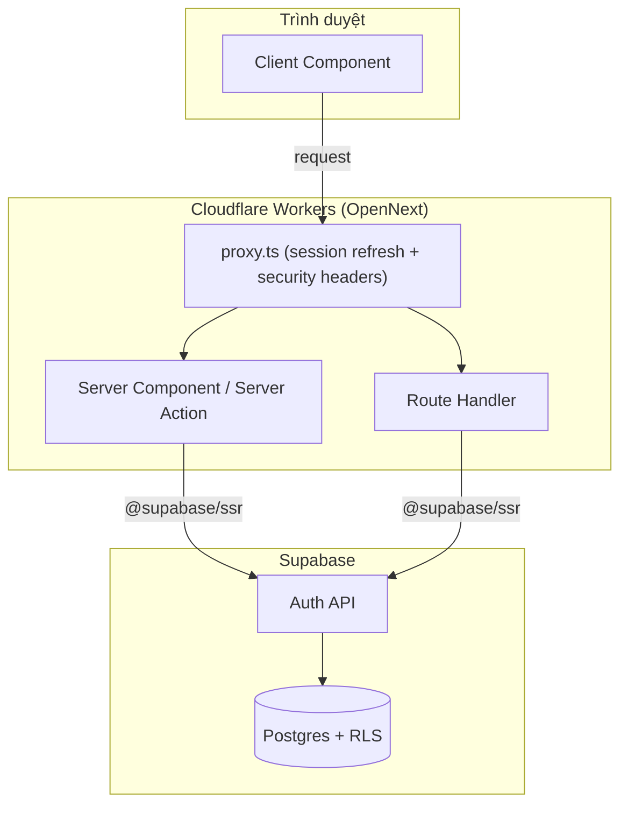
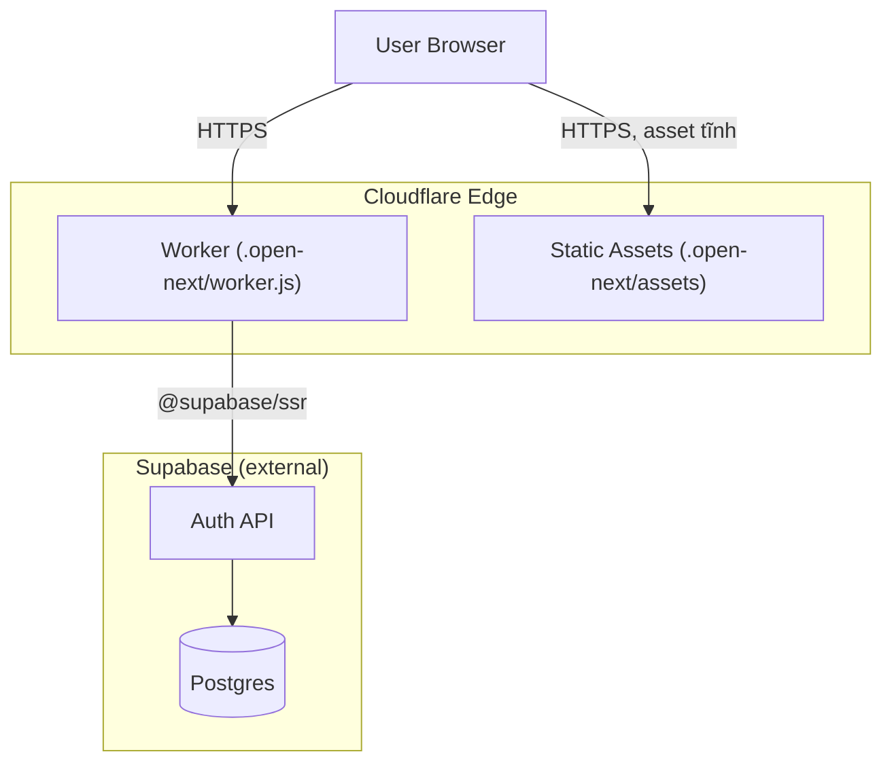

# Architecture

> Bản nháp forward-authored (Stage 1.5, greenfield) — dựng trước khi code tồn tại, dựa trên
> `plans/reports/researcher-cloudflare-workers-deployment.md` và
> `plans/reports/researcher-supabase-nextjs-integration.md`. Sẽ được Core pass đối chiếu lại
> (reconcile) với code thật sau khi tính năng `project-foundation` được implement. Mọi code
> `ROUTE###`/`MODEL###` chưa tồn tại được ghi `TBD (draft)`, không bịa số.

## System Architecture

Ứng dụng là một Next.js 16 (App Router) chạy trên Cloudflare Workers, nói chuyện với Supabase
(Postgres + Auth) qua REST/Auth API. Không có tầng API Gateway hay service riêng biệt nào khác —
Next.js tự đóng vai trò cả frontend (Server/Client Component) lẫn backend (Server Action, Route
Handler) trong cùng một Worker.

## Tech Stack

| Layer | Technology | Version |
|-------|------------|---------|
| Frontend/Backend (hợp nhất) | Next.js (App Router) | 16.x |
| Deploy adapter | `@opennextjs/cloudflare` | hiện tại (GA từ Next 16.2) |
| Hosting/Runtime | Cloudflare Workers (`nodejs_compat`) | `compatibility_date >= 2024-09-23` |
| Data store / Auth | Supabase (Postgres + Auth) | dự án Supabase hiện có (TBD (draft) — chưa xác nhận trên dashboard) |
| Styling | Tailwind CSS v4 (CSS-first `@theme`) | đã có trong scaffold |

## Deployment Layer — Cloudflare Workers qua OpenNext

**Lựa chọn adapter:** `@opennextjs/cloudflare`, không dùng `@cloudflare/next-on-pages` (đã deprecated,
repo archived) hay `vinext` (còn beta, chưa hỗ trợ đầy đủ Cache Components/PPR — hai flag này đang
bật sẵn trong `next.config.ts` của dự án). Lý do chọn OpenNext được ghi chi tiết ở
`plans/reports/researcher-cloudflare-workers-deployment.md`; **một ADR (`docs/decisions/ADR-*.md`)
có thể cần thiết để ghi lại quyết định này và các mốc revisit `vinext`** — bản thảo này chỉ nêu ý
định, không tự viết ADR.

- **Runtime:** OpenNext build output chạy trên **Node.js runtime** của Workers (qua flag
  `nodejs_compat`), không phải Edge runtime thuần — đây là điều kiện bắt buộc để `@supabase/ssr`
  hoạt động được (xem Supabase research: `@cloudflare/next-on-pages` build fail với Supabase do
  thiếu `buffer`/`fs`).
- **Middleware (`proxy.ts`)** vẫn chạy trên Edge runtime bất kể adapter — bất cứ API Node-only nào
  (ví dụ `cookies()` kiểu Node, `crypto` kiểu Node) dùng trong `proxy.ts` sẽ fail ở request-time,
  không fail ở build-time. Đây là điểm cần cẩn trọng nhất khi viết session-refresh middleware.
- **Cấu hình dự kiến:** `wrangler.jsonc` (root, `TBD (draft)` — chưa tồn tại), `open-next.config.ts`
  (root, `TBD (draft)`), script `cf:build`/`cf:preview`/`cf:deploy` trong `package.json`.
- **Giới hạn cần theo dõi:** bundle size cap 3 MiB (free) / 10 MiB (paid), gzip — chưa phải vấn đề ở
  scaffold hiện tại nhưng cần theo dõi khi dependency tăng lên.
- **Môi trường dev chưa xác nhận:** hỗ trợ Windows native cho `opennextjs-cloudflare build`/
  `wrangler dev` chưa được Cloudflare xác nhận đầy đủ — xem
  `technical-spec.md § 5.3` của tính năng `project-foundation`.

## Integration Layer — Supabase (service/data-store mới)

Supabase là data-store + identity provider duy nhất của hệ thống ở giai đoạn này, truy cập qua ba
client factory tách biệt theo ngữ cảnh chạy:

| Client | Dùng ở đâu | Factory (planned) |
|---|---|---|
| Browser client | Client Component | `lib/supabase/client.ts` — `createBrowserClient()` |
| Server client | Server Component / Server Action / Route Handler | `lib/supabase/server.ts` — `createServerClient()`, cookie adapter `getAll()`/`setAll()` |
| Admin client | Chỉ file server-only, không bao giờ import từ "use client" | `lib/supabase/admin.ts` — dùng secret key, bypass RLS |

**Session refresh** chạy ở `proxy.ts` trên mọi request khớp matcher — gọi `getClaims()` (không
dùng `getSession()`, vì `getSession()` không xác thực chữ ký JWT) rồi copy cookie đã rotate sang
response. Chi tiết hành vi từng action nằm ở
`spec/project-foundation/technical-spec.md § 3.2` (CAP-02).

**Dependency hướng đi (data flow):** Client Component → (qua `proxy.ts`) → Server
Component/Action/Route Handler → `@supabase/ssr` → Supabase Auth API / PostgREST → Postgres (với
RLS). Không có hàng đợi (queue), không có service trung gian nào khác ở giai đoạn này.

## Deployment View

> Derived from thiết kế dự định trong `plans/reports/researcher-cloudflare-workers-deployment.md`
> và `plans/reports/researcher-supabase-nextjs-integration.md` — chưa verify trên production thật,
> vì chưa có lần deploy nào diễn ra.

| Node / Edge | Description | Source |
|-------------|--------------|--------|
| Worker | Chạy toàn bộ Next.js SSR/Server Action/Route Handler sau khi OpenNext build | `TBD (draft)` — chưa có `wrangler.jsonc` |
| Static Assets | `public/` + `_next/static/` — Cloudflare phục vụ trực tiếp, không qua Worker | `TBD (draft)` — chưa có `public/_headers` |
| Worker → Supabase | Gọi Auth API/PostgREST qua `@supabase/ssr` cho mọi action cần xác thực/dữ liệu | `TBD (draft)` — chưa có `lib/supabase/*.ts` |

**Degradation:** chưa có infrastructure-as-code nào tồn tại trong repo ở thời điểm viết bản nháp
này (`wrangler.jsonc` chưa được tạo) — sơ đồ trên phản ánh Ý ĐỊNH thiết kế, không phải cấu hình đã
xác nhận; sẽ được Core pass đối chiếu lại với `wrangler.jsonc`/`open-next.config.ts` thật sau khi
implement.
