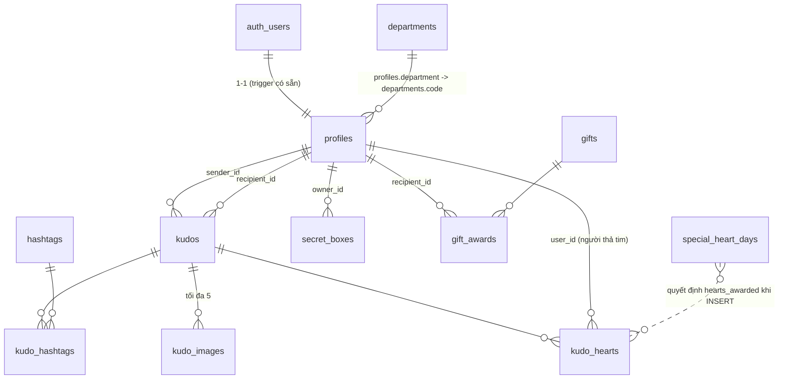

# Thiết kế DB — Sun* Kudos (#11 Live board, #12 Viết Kudo, #13 Like)

Một migration tạo đủ bảng cho cả 3 tính năng; plan này chỉ dùng phần **đọc**. RPC ghi
(`create_kudo`, `toggle_kudo_heart`, `open_secret_box`) thuộc plan #12/#13/Secret Box sau.
Nguồn: spec `MaZUn5xHXZ` (live board), `ihQ26W78P2` (Viết Kudo — Figma có trường **Danh hiệu**),
`J3-4YFIpMM` (Secret Box), `WXK5AYB_rG` / `JWpsISMAaM` (dropdown), frame hover danh hiệu / x2 tim.

## ERD

## Bảng

| Bảng | Cột chính | Ràng buộc / ghi chú |
|------|-----------|---------------------|
| `departments` | `code text pk`, `sort_order smallint` | ~49 mã lấy **từ node tree** Figma `WXK5AYB_rG` (chuỗi trong CSV dính dấu cách, không tách được). Dữ liệu danh mục → nằm trong migration. |
| `profiles` (có sẵn) | thêm FK `department → departments(code) on update cascade on delete set null` | Cột `department text` đã có, luôn null → thêm FK an toàn, **không** đổi `profileSchema`, không đụng trigger đăng nhập. |
| `hashtags` | `id smallint identity pk`, `slug text unique`, `name_vi`, `name_en`, `sort_order` | 13 tag từ spec `JWpsISMAaM`; `name_en` lấy qua `list_file_localizations`. Slug dùng trên URL. |
| `kudos` | `id uuid pk default gen_random_uuid()`, `sender_id`, `recipient_id` (FK profiles, `on delete cascade`), `title text` (danh hiệu, vd "IDOL GIỚI TRẺ"), `content text`, `is_anonymous bool default false`, `anonymous_name text`, `heart_count int default 0`, `created_at timestamptz default now()` | `check (sender_id <> recipient_id)`; `check (char_length(btrim(title)) between 1 and 100)`; `check (char_length(content) between 1 and 5000)`; `check (is_anonymous or anonymous_name is null)`. `content` = Markdown con (B/I/S/list/link/quote, mention `@[Tên](uuid)`) — #12 chốt bộ render; #11 chỉ hiện plain text. `heart_count` phi chuẩn hoá, trigger giữ. |
| `kudo_hashtags` | `kudo_id`, `hashtag_id`, pk(kudo_id, hashtag_id) | Tối đa 5/kudo: kiểm ở RPC `create_kudo` (#12). |
| `kudo_images` | `id`, `kudo_id`, `image_url text`, `position smallint` | `check (position between 1 and 5)`, unique(kudo_id, position). #12 ghi URL Storage; seed ghi `/images/kudos/demo/*`. |
| `kudo_hearts` | `kudo_id`, `user_id`, `hearts_awarded smallint`, `created_at`, pk(kudo_id, user_id) | PK = mỗi người 1 lượt. `check (hearts_awarded in (1,2))`. Trigger BEFORE INSERT: chặn `user_id = kudos.sender_id`; **server tự gán** `hearts_awarded` = 2 nếu `now()` thuộc `special_heart_days`, ngược lại 1 → bỏ tim thu hồi đúng số đã cộng (QA note C.4.1). AFTER INSERT/DELETE: `kudos.heart_count ± 1`. |
| `special_heart_days` | `id`, `starts_at`, `ends_at` | `check (ends_at > starts_at)`. Admin cấu hình "Ngày x2 tim". |
| `secret_boxes` | `id`, `owner_id`, `badge text`, `opened_at`, `created_at` | `check ((opened_at is null) = (badge is null))`; `badge in ('stay_gold','flow_to_horizon','beyond_the_boundary','root_further','touch_of_light','revival')`. Luật được nhận box: chưa có spec → chỉ seed. |
| `gifts` | `id smallint identity`, `name_vi`, `name_en` | vd "1 áo phông SAA". |
| `gift_awards` | `id`, `recipient_id`, `gift_id`, `awarded_at` | Nguồn "10 Sunner nhận quà mới nhất". |

Index: `kudos(created_at desc, id desc)`, `kudos(heart_count desc, created_at desc)`, `kudos(recipient_id)`,
`kudos(sender_id)`, `kudo_hashtags(hashtag_id)`, `kudo_hearts(user_id)`, `secret_boxes(owner_id)`,
`gift_awards(awarded_at desc)`, `profiles(department)`.

## Quy tắc tính (TS thuần, unit test — DB chỉ trả số đếm)

- **Danh hiệu Hero** theo số người gửi khác nhau (`distinct_senders`, Figma hover): 0 → không badge, 1–4 New, 5–9 Rising, 10–20 Super, >20 Legend.
- **Hoa thị** theo số Kudo nhận (`kudos_received`, spec B.3.2): ≥10 → 1, ≥20 → 2, ≥50 → 3.
- **Tim nhận được** (D.1.4) = `sum(hearts_awarded)` trên tim của các kudo **mình gửi** (spec C.4.1 ghi người gửi được cộng — xem câu hỏi mở trong `clarifications.md`).
- Ẩn danh: RPC trả `sender = null` + `anonymous_name`; `is_mine` vẫn đúng cho người gửi (để #13 disable tim).

## Truy cập: RLS + RPC

- RLS **bật trên mọi bảng mới**; `revoke all` khỏi `anon`, `authenticated` như migration profiles.
- Danh mục (`departments`, `hashtags`, `gifts`): `grant select` cho `authenticated` + policy `is_allowed_account(jwt)`.
- Bảng giao dịch (`kudos`, `kudo_*`, `secret_boxes`, `gift_awards`, `special_heart_days`): **không** grant, không policy → chỉ đọc qua RPC. Lý do: phải che `sender_id` của Kudo ẩn danh, RLS không che được cột.
- Mọi RPC: `security definer`, `set search_path = ''`, `stable`, kiểm `public.is_allowed_account(auth.jwt()->>'email', auth.jwt()->'app_metadata')` đầu hàm (sai → trả rỗng), `revoke execute from public, anon`, `grant execute to authenticated`.

| RPC (đọc, plan này) | Tham số | Trả về |
|---|---|---|
| `kudos_feed` | `p_hashtag text, p_department text, p_cursor_created_at timestamptz, p_cursor_id uuid, p_limit int default 10` (≤ 20) | `setof` dòng Kudo (dưới) theo `created_at desc, id desc`, keyset |
| `kudos_highlight` | `p_hashtag, p_department` | tối đa 5 dòng Kudo, `heart_count desc, created_at desc` |
| `kudos_spotlight` | — | `jsonb {total, recipients:[{id, full_name, kudos_count, last_received_at, last_kudo_id}], recent:[{recipient_name, created_at}] (5)}` — **không** theo bộ lọc |
| `kudos_my_stats` | — | `received, sent, hearts_received, boxes_opened, boxes_unopened` của `auth.uid()` |
| `kudos_latest_gift_recipients` | `p_limit int default 10` | `recipient jsonb, gift_name_vi, gift_name_en, awarded_at` |

Dòng Kudo: `id, created_at, title, content, is_anonymous, anonymous_name, heart_count, liked_by_me, is_mine,
sender jsonb|null, recipient jsonb, hashtags jsonb [{slug,name_vi,name_en}], images jsonb [url theo position]`.
Person jsonb: `{id, full_name, avatar_url, department, kudos_received, distinct_senders}`.
Lọc phòng ban = phòng ban **người nhận** (spec `WXK5AYB_rG` A.1). Hai bộ lọc kết hợp AND.

## Seed demo (không phải migration)

`supabase/seed/20261015_kudos_demo_seed.sql` (idempotent) + `supabase/seed/kudos_demo_seed_cleanup.sql`:
~20 user `demo.sunnerNN@sun-asterisk.com` chèn vào `auth.users` (`raw_app_meta_data` provider google +
`"seed":"kudos-demo"`, không mật khẩu/identity → không đăng nhập được), cập nhật `profiles`
(tên, `avatar_url = /images/kudos/demo/avatar-0{1..4}.png`, phòng ban), ~60 kudo rải 30 ngày, hashtag,
ảnh `/images/kudos/demo/kudo-photo-0{1..5}.jpg`, tim, quà, secret box; thêm vài kudo gửi/nhận cho **mọi
profile thật đang có** để thống kê cá nhân khác 0. Cleanup: `delete from auth.users where raw_app_meta_data->>'seed' = 'kudos-demo'` (cascade).
Chỉ chạy trên môi trường demo; header file ghi rõ.
